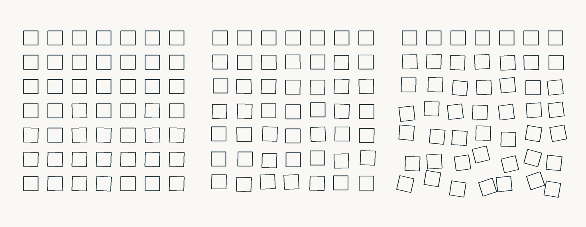
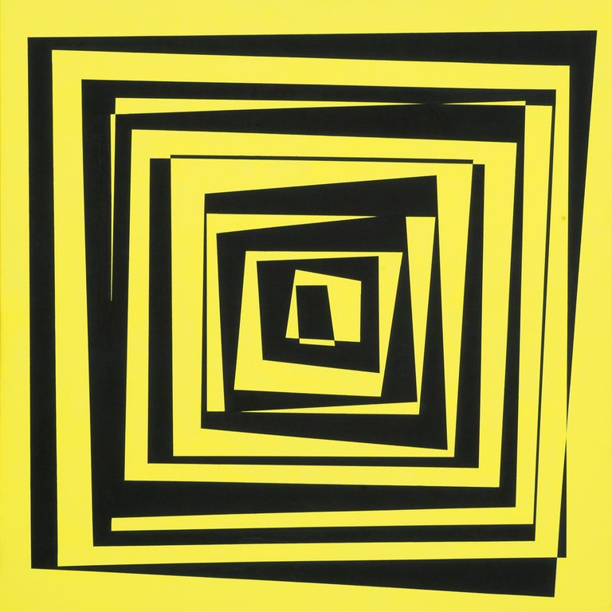

# Generatív művészet

A generatív művészet olyan alkotói gyakorlat, amelyben a mű létrehozásában egy előre meghatározott eljárás vagy rendszer is szerepet kap. A rendszer lehet szabályok leírása, számítógépes program, mechanikus szerkezet vagy természetes folyamat. A művész feladata ilyenkor nem minden részlet közvetlen megrajzolása: a létrehozás feltételeit és a rendszer működését határozza meg. Philip Galanter művészetelméleti meghatározása ennek a részben önálló alkotási folyamatnak a szerepét hangsúlyozza; a [MoMA fogalomtára](https://www.moma.org/collection/terms/generative-art) szintén az autonóm rendszerre, illetve a számítógépes kód lehetséges használatára helyezi a hangsúlyt. [Galanter: *What is Generative Art?* (2003)](https://www.generativeart.com/on/cic/papersGA2003/a22.htm)

A generatív művészet tehát nem azonos a számítógéppel előállított képek összességével. A módszer számítógép nélkül is alkalmazható, ahogyan a számítógép is használható olyan képalkotási feladatra, amelyben minden részletet közvetlenül az alkotó jelöl ki. Az algoritmikus eljárás jelentősége abban áll, hogy a szerkesztési szabályok következetesen alkalmazhatók, ismételhetők és paraméterekkel módosíthatók.

## Szerkesztési szabályok és változatok {#szabalyok}

Az algoritmikus képalkotás kiindulópontja rendszerint egy viszonylag egyszerű szerkesztési feladat. Egy geometrikus kompozícióban meghatározhatjuk az alkalmazott alakzatokat, a köztük lévő távolságot, az ismétlés rendjét és a megengedett eltéréseket. Ezek egy része állandó maradhat, mások értéke rajzonként vagy akár elemenként is változhat. Ugyanabból az alapstruktúrából ezért több különböző kompozíció keletkezhet.

A három változat ugyanazt a négyzetrácsot használja. A különbséget nem az alakzatok típusa vagy száma, hanem a megengedett eltolás és forgatás mértéke adja. A paraméterek módosítása így nem pusztán díszítő lehetőség, hanem a kompozíció szerkezetét meghatározó döntés.

A véletlen alkalmazása ehhez további változatosságot adhat. Fontos azonban megkülönböztetni a véletlen értéket **a véletlen felhasználásának szabályától**. Az alkotó meghatározhatja például, hogy egy négyzet legfeljebb mekkora szögben fordulhat el, az eltérés milyen irányban történhet, illetve mekkora valószínűséggel marad el. A véletlen tehát a megadott korlátok között működik, és nem minden elemre szükségszerűen azonos módon hat.

A számítógépes programok ehhez rendszerint pszeudovéletlen számokat használnak. Ugyanabból a kezdőértékből (*seed*) azonos véletlenszám-sorozat állítható elő, ezért a kísérletek megismételhetők. Ez különösen akkor hasznos, ha két kép között egyetlen paraméter hatását szeretnénk vizsgálni. Az elkészült változatok kiválasztása, egymáshoz viszonyítása és szükség szerinti további módosítása továbbra is az alkotói folyamat része.

## Történeti áttekintés {#tortenet}

A szabályokon és ismétlésen alapuló képalkotásnak a digitális korszak előtti előzményei is vannak. A geometrikus absztrakció, a kombinatorikus eljárások és a véletlent alkalmazó kísérletek különböző művészeti irányzatokban jelentek meg. A konceptuális művészetben különösen hangsúlyossá vált az a lehetőség, hogy az alkotás szöveges utasítások alapján, az alkotótól eltérő személy közreműködésével is megvalósítható. A generatív művészet története ezért nem kizárólag a számítógép történeteként írható le.

A számítógéppel vezérelt rajzolás az 1960-as években vált a képzőművészeti kísérletezés egyik eszközévé. A korabeli rendszerek számítással határozták meg a pontok és vonalak koordinátáit, amelyeket gyakran tollas rajzgépek, úgynevezett *plotterek* vittek papírra. A médium korlátai – különösen a vonalrajz és a számítási kapacitás – a művek formavilágára is hatással voltak. Az 1968-as londoni *Cybernetic Serendipity* kiállítás a művészet, a számítás és a kibernetika kapcsolatának meghatározó korai eseménye volt. [V&A: *Digital Art*](https://www.vam.ac.uk/articles/digital-art)

A hetvenes évektől a generatív eljárások egyre változatosabb médiumokban jelentek meg, köztük számítógépes animációban, interaktív rendszerekben és térbeli munkákban. A digitális eszközök fejlődése nem változtatta meg az alapvető alkotói kérdést: milyen szabályokból milyen képi lehetőségek következnek, és ezek közül melyeket tekintjük az adott mű releváns megvalósulásának?

## Alkotók és művek {#alkotok}

A következő alkotók munkái eltérő módon mutatják meg a szerkesztési szabályok, a számítógépes eljárások és az alkotói döntések kapcsolatát. A reprodukciók mellett az eredeti gyűjteményi vagy alkotói oldalak is szerepelnek, ahol a művek további adatai megtekinthetők.

**Sol LeWitt – *Wall Drawing #289* (1976).** LeWitt falrajzainál az utasítások meghatározzák a lehetséges kivitelezést, de a konkrét megvalósítás a helyszíntől és a kivitelezéstől is függhet. A példa azt mutatja, hogy a szabályok alapján létrejövő mű nem igényel feltétlenül számítógépet. [Whitney Museum – LeWitt munkássága](https://whitney.org/education/families/kids-art-challenge/sol-lewitt).

**Frieder Nake – *Hommage à Paul Klee Nr. 2* (1965).** Az alkotás a korai számítógépes grafika egyik példája: a vonalak és alakzatok elhelyezését programmal meghatározott szerkesztési eljárás szabályozta. Nake munkái összekapcsolják a geometriai szervezést a számításos változatképzéssel. [ZKM – műadatlap](https://zkm.de/en/artworks/hommage-a-paul-klee-nr-2).

**Georg Nees – *Schotter* (1968–1970).** A négyzetrács elemei a kompozíció előrehaladtával egyre nagyobb elmozdulást és forgást kapnak. A mű szerkezete megmarad, miközben a megengedett eltérések növekednek. A fokozatosság és a véletlen kapcsolata a korábbi fejezetek Processing-példáival is könnyen szemléltethető. [V&A – műadatlap](https://collections.vam.ac.uk/item/O221321/schotter-print-nees-georg/).

**Vera Molnár – *Interruptions* (1968–1969) és *Transzformáció 15.* (1975).** Molnár munkásságában a szabályos geometriai szerkezetek módszeres változtatása központi szerepet kapott. A vonalak megszakítása, az alakzatok elmozdítása vagy a szigorúan meghatározott rend feloldása a kompozíció önálló szerkesztési eszköze. A második mű jól mutatja az egymásba rendezett alakzatok kis mértékű eltolásának és torzításának hatását. [Morgan Library – *Interruptions*](https://www.themorgan.org/drawings/item/405692); [Fővárosi Képtár – *Transzformáció 15.*](https://fovarosikeptar.hu/kiallitasok-2019-ben-templomter/rendetlenseg-a-rendben-vera-molnar-muveszete/).

A *Transzformáció 15.* reprodukciója a tananyag saját állományából töltődik be. Az *Interruptions à recouvrements* (1969) további képe a [Wikimedia Commons gyűjteményében](https://commons.wikimedia.org/wiki/File:Vera_Molnar._Interruptions_%C3%A0_recouvrements%E2%80%9D_from_1969.jpg) található.

**Manfred Mohr – *P-197 J* (1979).** Mohr a kocka geometriai szerkezetéből kiindulva állított elő variációkat. Az élek és kapcsolatok vetítései különböző vonalas konfigurációkat eredményeznek. Az eljárásban ugyanaz az alapszerkezet több különböző formában jelenhet meg. [Mercedes-Benz Art Collection – műadatlap](https://www.mercedes-benz.art/en/artwork/p-197-j-manfred-mohr-1979/); [Digital Art Museum – Mohr munkái](https://dam.org/museum/artists_ui/artists/mohr-manfred/).

**John Whitney – *Arabesque* (1975).** Whitney a matematikai összefüggésekre és ismétlődő mozgásokra épülő számítógépes animáció úttörője volt. Az *Arabesque* a geometrikus szerkezetek folyamatos térbeli és időbeli átalakulását hangsúlyozza. Példája megmutatja, hogy a generatív eljárás eredménye nemcsak állókép, hanem mozgókép is lehet. [ACMI – műadatlap és megtekintési lehetőség](https://www.acmi.net.au/works/114089--arabesque/).

**Harold Cohen – *AARON*, például *Susan with Plant* (1991).** Cohen az AARON rendszerét több évtizeden át fejlesztette. A programnak megadott alak-, elhelyezési és rajzolási szabályok segítségével figurális kompozíciók is készülhettek. Munkássága ezért jó ellenpélda arra a feltevésre, hogy az algoritmikus képgenerálás csak absztrakt geometriát eredményezhet. [Whitney Museum – AARON](https://whitney.org/exhibitions/harold-cohen-aaron/art?section=2).

**Casey Reas – *{Software} Structures* (2004).** Reas munkái a művész által megfogalmazott szabályokat és azok szoftveres megvalósításait állítják előtérbe. A projektben három szövegesen leírt szerkezet alapján huszonhat program készült; az eltérő megvalósítások a szabályok értelmezésének szerepét is láthatóvá teszik. A műveket a Whitney Museum online gyűjteménye is bemutatja. [Whitney Museum – *{Software} Structures*](https://whitney.org/exhibitions/software-structures); [Casey Reas – *Process*](https://reas.com/process).

A példák eltérő műfajokból származnak, mégis ugyanazt a kérdést teszik vizsgálhatóvá: mely tulajdonságokat határozza meg közvetlenül az alkotó, és melyek adódnak az eljárás végrehajtásából?

## Módszerek és eszközök {#eszkozok}

Az algoritmikus képalkotás alapműveletei között az ismétlés, a feltételes döntés, a számított koordináták, a véletlen értékek és a geometriai transzformációk szerepelnek. Az ismétlés szabályos vagy módosuló elrendezéseket hozhat létre, a feltételek eltérő megjelenítési szabályokat jelölhetnek ki, míg a véletlen és a zajfüggvények változatosságot vagy összefüggő eltéréseket vezethetnek be. Más munkákban külső adatok, fizikai folyamatok vagy a felhasználó közreműködése is befolyásolhatja az eredményt.

A képek mellett animációk, interaktív installációk, térbeli jelenetek és fizikai rajzgépekkel készített munkák is használhatnak generatív módszereket. Az egyes eszközök elsősorban abban különböznek, hogy milyen módon lehet megfogalmazni és végrehajtani a szerkesztési eljárásokat. A Processing és a [p5.js](https://p5js.org/) programkóddal, a [TouchDesigner](https://derivative.ca/) többek között vizuális csomópontokkal szervezett, valós idejű rendszerekkel dolgozik; a Python grafikus könyvtárai és a GLSL-shaderek más megvalósítási lehetőségeket kínálnak.

A további fejezetekben a Processing alapvető eszközeit használjuk arra, hogy a hallgatók képesek legyenek egy kompozíció szerkezetét felismerni, a szükséges műveleteket megfogalmazni, majd egy működő megoldás paramétereit tudatosan változtatni. A cél nem egyetlen helyes kép reprodukálása, hanem annak megértése, hogyan jönnek létre az eltérő eredmények ugyanazon eljárás alapján.
