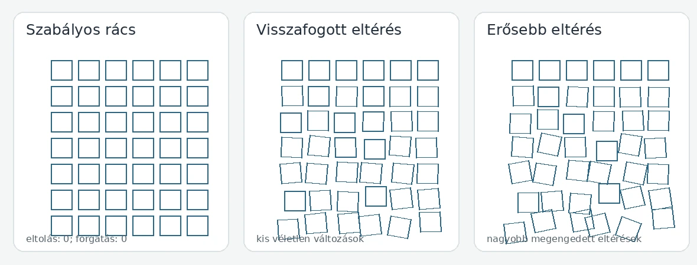
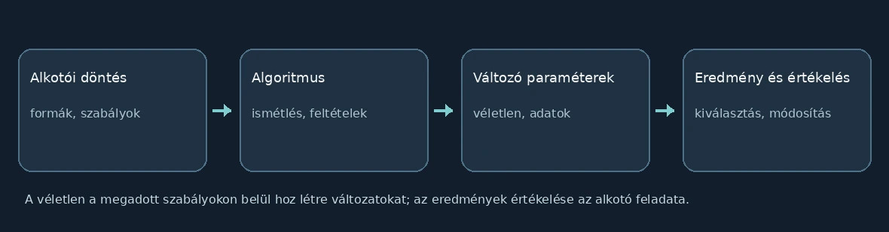

# Generatív művészet

A generatív művészetben az alkotó nem feltétlenül határozza meg közvetlenül a mű minden egyes részletét. Ehelyett **szabályokat és eljárásokat** fogalmaz meg, amelyek meghatározzák, hogy milyen elemek jelenhetnek meg, hogyan kapcsolódhatnak egymáshoz, illetve milyen változások történhetnek. Az így létrehozott rendszer önállóan is előállíthat egy vagy több eredményt.

A generatív művészet nem azonos a számítógépes művészettel: a szabályrendszer végrehajtható kézzel, mechanikus eszközzel vagy természetes folyamat segítségével is. A számítógép azért vált különösen fontos eszközzé, mert nagy mennyiségű műveletet képes pontosan és gyorsan megismételni, miközben a paramétereket is változtathatja. A [Museum of Modern Art](https://www.moma.org/collection/terms/generative-art) meghatározása az autonóm rendszerek és a véletlen szerepét, a [Whitney Museum](https://whitney.org/exhibitions/programmed/art?section=2) értelmezése pedig a művész által létrehozott szabályrendszernek átadott részleges irányítást emeli ki.

## A szabályrendszer szerepe {#szabalyok}

A generatív eljárás alapja egy **megfogalmazható szerkesztési elv**. Például négyzeteket helyezünk el egy szabályos rácsban, majd az egyes négyzetek helyét és elforgatását bizonyos feltételek mellett módosítjuk. Egy ilyen program sok különböző képet készíthet úgy, hogy közben a szerkesztési alapelv változatlan marad.

A szabály meghatározhatja például az alakzatok típusát, számát és méretét, az elhelyezésük módját, a színek kiválasztását, az ismétlések számát, illetve az egyes elemek közötti kapcsolatokat. Az alkotó dönt arról is, **mely jellemzők maradjanak állandók, és melyek változhassanak**.

### A véletlen tudatos használata

A véletlen nem feltétlenül a szabályok hiányát jelenti. Egy rendszerben pontosan meghatározhatjuk, hogy mi változhat véletlenszerűen, milyen tartományban, és milyen valószínűséggel. Egy négyzetrácsban például megengedhetjük az elemek elforgatását, miközben a méretük változatlan marad. Egy másik esetben a forgatás mértéke a kép egyik szélétől a másikig fokozatosan növekedhet.

A számítógépes példákban többnyire *pszeudovéletlen* számokat használunk. Ezek egy meghatározott eljárás eredményei; azonos kezdőérték, azaz *seed* mellett a véletlenszám-sorozat megismételhető. Ez különösen hasznos, ha két kompozíció között csak egyetlen szabály hatását szeretnénk összehasonlítani.

**Az alkotói döntés nem ér véget a program megírásával.** A létrejött változatok megvizsgálhatók, a paraméterek módosíthatók, és az alkotó kiválaszthatja a megfelelő eredményeket. Az algoritmus így nem egyszerűen helyettesíti az alkotót, hanem egy általa meghatározott alkotási folyamat része.

## Az algoritmikus művészet kialakulása {#tortenet}

A szabályokon alapuló alkotásnak vannak a számítógépek elterjedése előtti előzményei is. A geometrikus absztrakció, a kombinatorikus szerkesztés és a véletlent használó művészeti kísérletek egyaránt fontosak ebből a szempontból. A hatvanas évek konceptuális művészetében különösen hangsúlyossá vált az elképzelés, hogy egy alkotás részletes utasítások alapján, akár mások közreműködésével is létrejöhet.

A számítógépes grafikai kísérletek az **1960-as években** jelentek meg a képzőművészetben. Georg Nees, Frieder Nake és A. Michael Noll korai munkáiban algoritmusok vezéreltek rajzgépeket (*plottereket*), amelyek tollal vitték papírra a kiszámított vonalakat. A korabeli számítógépek megjelenítési lehetőségei korlátozottak voltak, a szabályok változtatása viszont új képsorozatok létrehozását tette lehetővé. Az 1968-as londoni *Cybernetic Serendipity* kiállítás a számítógép, a kibernetika és az alkotás kapcsolatának egyik fontos korai bemutatkozása volt. [V&A – Digital Art](https://www.vam.ac.uk/articles/digital-art), [V&A – Chance and Control](https://www.vam.ac.uk/exhibitions/chance-and-control-art-in-the-age-of-computers).

A következő évtizedekben az algoritmikus alkotás kiterjedt a mozgóképre, az interaktív installációkra, a térbeli megjelenítésre és a hangra is. A programozás mellett mechanikus rendszerek, érzékelők és külső adatok is lehetnek egy generatív rendszer részei. Napjainkban a generatív művészet fogalma különféle digitális és nem digitális eljárásokat is magában foglal.

## Alkotók és művek {#alkotok}

Az alábbi alkotások különböző módon használják a szabályokat, az ismétlést, a számításokat vagy a véletlent. A művek képei a megjelölt külső gyűjteményekből töltődnek be; a hivatkozásokon az eredeti műleírások is megnyithatók. A képek nem a jelen tananyag számára készített újraalkotások.

**Sol LeWitt – Wall Drawing #289 (1976).** LeWitt falrajzai olyan utasításokon alapulnak, amelyeket az alkotó nem feltétlenül saját maga hajt végre. Az elkészült mű elhelyezése és részletei az adott helyszínhez, valamint az utasítások értelmezéséhez is kapcsolódnak. A módszer jól mutatja, hogy generatív rendszer **számítógép nélkül is működhet**. [A mű bemutatása – Whitney Museum](https://whitney.org/education/families/kids-art-challenge/sol-lewitt).

**Georg Nees – Schotter (1968–1970).** A mű szabályos négyzetráccsal indul, majd soronként egyre nagyobb eltolások és forgatások jelennek meg. A fokozatosan növekvő rendezetlenség nem véletlen mellékhatás, hanem a szerkesztési elv része. Ez az egyik legközvetlenebb példa arra, hogyan változik egy kompozíció a véletlen megengedett tartományának módosításával. [Műadatlap – Spalter Digital](https://spalterdigital.com/artworks/953) és [V&A-gyűjtemény](https://collections.vam.ac.uk/item/O221321/schotter-print-nees-georg/).

**Frieder Nake – Hommage à Paul Klee Nr. 2 (1965).** Nake különféle vonalakat, alakzatokat és rácsszerkezeteket használt a számítógéppel vezérelt rajzolásban. A mű egyszerre utal Paul Klee festészetére és az algoritmikus képalkotás sajátosságaira: a program részletes szerkesztési szabályokat követ, de azok eltérő eredményeket is lehetővé tesznek. [Műadatlap – ZKM Karlsruhe](https://zkm.de/en/artworks/hommage-a-paul-klee-nr-2).

**Vera Molnár – Interruptions (1968–1969).** Molnár az ismétlődő geometrikus szerkezetekbe tudatosan bevezetett eltéréseket. Az *Interruptions* sorozatban a vonalak szabályosságát hiányok, megszakítások és véletlenszerű eltérések bontják meg. Munkái különösen szemléletesek a **rend és a megengedett rendezetlenség** kapcsolatának megértéséhez. [Műleírás – Morgan Library & Museum](https://www.themorgan.org/drawings/item/405692), [Digital Art Museum – Interruptions](https://dam.org/museum/artists_ui/artists/molnar-vera/interruptions/).

**Harold Cohen – AARON, például Susan with Plant (1991).** Cohen több évtizeden keresztül fejlesztette az *AARON* nevű képgeneráló rendszerét. A program nem egyszerűen véletlen alakzatokat rajzolt, hanem előre megfogalmazott szabályok segítségével hozott létre figurális kompozíciókat is. Jó példa arra, hogy a generatív eljárás nem korlátozódik geometrikus absztrakcióra. [Harold Cohen: AARON – Whitney Museum](https://whitney.org/exhibitions/harold-cohen-aaron/art?section=2).

Az egyes műveknél nem elsősorban a felhasznált programnyelv a lényeg. A fontosabb kérdés az, **mely részeket határozta meg az alkotó közvetlenül, és melyeket hozta létre a szabályrendszer**.

## Módszerek és eszközök {#eszkozok}

A generatív alkotásokban gyakran ugyanazokkal az alapvető eszközökkel találkozunk, amelyeket a későbbi fejezetekben Processingben is használunk. Az ismétlés sok hasonló elemet állít elő; a feltételek dönthetnek egy elem színéről, helyéről vagy megjelenéséről; a véletlen új változatokat eredményezhet. Az adatokból számított értékek, a zajfüggvények és a geometriai transzformációk összetettebb szerkezeteket tesznek lehetővé.

A generatív alkotás nem feltétlenül statikus kép. Ugyanaz a rendszer állíthat elő animációt, interaktív grafikát vagy térbeli jelenetet is. A rajzolás történhet képernyőn, nyomtatott felületen, plotterrel, vetítéssel vagy fizikai eszköz segítségével.

**Néhány elterjedt eszköz:**

- [Processing](https://processing.org/) – vizuális programozási környezet, amelyet ebben a tananyagban használunk.
- [p5.js](https://p5js.org/) – a Processing szemléletére épülő JavaScript-könyvtár böngészős alkalmazásokhoz.
- [TouchDesigner](https://derivative.ca/) – csomópontokkal szerkeszthető környezet valós idejű, gyakran interaktív vizuális rendszerekhez.
- Python és grafikus könyvtárai, valamint GLSL/shaderek – képgenerálásra, adatok vizuális feldolgozására és a grafikus hardver programozására használhatók.

### Generatív művészet és mesterséges intelligencia

A két fogalom nem azonos. Egy hagyományos algoritmikus alkotásnál a művész által megadott, értelmezhető szabályokból indulunk ki. Egy tanított generatív mesterségesintelligencia-modell ezzel szemben nagy adathalmazokból tanult mintázatok alapján is létrehozhat új képeket. A két terület között vannak átfedések, de nem minden generatív alkotás MI-alapú, és nem minden számítógéppel előállított kép generatív művészeti alkotás. Az [AARON története](https://whitney.org/exhibitions/harold-cohen-aaron/art?section=2) különösen jól mutatja, hogy ez a különbség történetileg is összetett.

**A kurzus célja** nem az, hogy a hallgatók minden alkalmazott algoritmust önállóan, részletes matematikai háttérrel tudjanak megtervezni. Arra törekszünk, hogy képesek legyenek felismerni egy alkotás alapvető építőelemeit, megfogalmazni a szerkesztési szabályokat, módosítani a paramétereket, és a létrejött eredményeket értékelni. Később azt is megvizsgáljuk, hogyan lehet egy elképzelt grafikai eljárást egy nyelvi modellel közösen pontosítani és megvalósítani.
