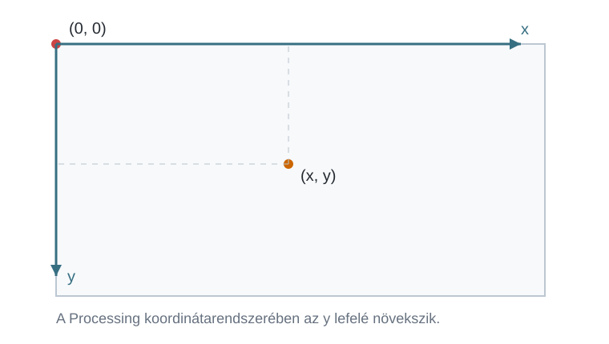

# Ablak és grafikus primitívek

**A Processing telepítése.** A Processing ingyenesen letölthető a [Processing hivatalos letöltési oldaláról](https://processing.org/download/). A letöltési oldalon Windows, macOS és Linux rendszerhez is elérhető a megfelelő változat. A telepítés után a Processing Development Environment (PDE) felületén hozzuk létre és futtatjuk a példaprogramokat.

## Hogyan épül fel egy Processing-program? {#program-felepitese}

A Processingben elkészített programot **sketchnek** nevezzük. Egy sketchben később sokféle utasítás szerepelhet, de az első programjainknál két kitüntetett részre érdemes figyelnünk: a `setup()` és a `draw()` metódusra.

A `setup()` a program indulásakor **egyszer** fut le. Itt állítjuk be azokat a dolgokat, amelyekre a program elején van szükségünk, például a rajzablak méretét. A `draw()` ezzel szemben a program futása közben újra és újra végrehajtódik. Erre akkor lesz szükségünk, amikor valamit mozgatni szeretnénk, vagy azt akarjuk, hogy a rajz reagáljon például az egér mozgatására.

```processing
void setup() {

}

void draw() {

}
```

A kapcsos zárójelek közötti rész tartozik az adott metódushoz. Ha például azt szeretnénk, hogy egy utasítás csak a program indulásakor fusson le, akkor azt a `setup()` kapcsos zárójelei közé írjuk. A Processingben a kis- és nagybetűk különbözőnek számítanak, ezért a `setup` és a `Setup` nem ugyanaz. Az utasításokat általában pontosvesszővel zárjuk.

**Egyelőre csak a `setup()` metódusban dolgozunk.** Így először arra tudunk figyelni, hogyan készül el egy egyszerű rajz. A `draw()` metódusra akkor térünk vissza, amikor már ismerjük a legfontosabb grafikus elemeket.

## Az ablak létrehozása {#ablak-letrehozasa}

A rajzoláshoz először szükségünk van egy ablakra. Ennek méretét a `size()` metódussal adjuk meg. Az első érték az ablak szélessége, a második a magassága, mindkettő pixelben.

:::processing-example title="Egy 640 × 360 pixeles ablak" image="media/ablak-hatter.webp"
```processing
void setup() {
  size(640, 360);
  background(240);
}
```

A `background(240)` világosszürke háttérrel tölti ki az ablakot.
:::

A fenti példában a `size(640, 360)` tehát egy 640 pixel széles és 360 pixel magas rajzfelületet hoz létre. A `background()` egyelőre egyetlen számmal szerepel. Ebben a formában a `0` fekete, a `255` fehér hátteret jelent, a köztes értékek pedig különböző szürkeárnyalatokat adnak.

## Rajzolás a koordinátarendszerben {#rajzolas-alapjai}

**A rajzfelület koordinátái.**

Amikor egy alakzat helyét megadjuk, koordinátákat használunk. A Processing koordinátarendszere elsőre kissé szokatlan lehet, mert a `(0, 0)` pont a rajzfelület **bal felső sarkában** található. Az `x` koordináta jobbra, az `y` koordináta pedig lefelé növekszik.



Ha például egy pontot a `(100, 50)` helyre rajzolunk, akkor a bal széltől 100, a felső széltől 50 pixelt lépünk.

**Pont és vonal.**

A legegyszerűbb grafikus primitív a pont. A `point(x, y)` azt mondja meg, hogy melyik koordinátára kerüljön. Egy vonalhoz két pontot kell megadnunk: a `line(x1, y1, x2, y2)` első két értéke a vonal egyik, a második két értéke a másik végpontja.

:::processing-example title="Pont és vonal" image="media/pont-vonal.webp"
```processing
void setup() {
  size(640, 360);
  background(248);

  stroke(0);
  strokeWeight(10);
  point(110, 110);

  stroke(20, 90, 180);
  strokeWeight(4);
  line(180, 90, 520, 270);
}
```

A `stroke()` és a `strokeWeight()` most azért jelenik meg, hogy a pont és a vonal jól látható legyen. A következő részben pontosan megnézzük, mit jelentenek.
:::

**Toll és ecset.**

A Processinget elképzelhetjük úgy, mint egy egyszerű rajzgépet. Mielőtt rajzolni kezd, beállíthatjuk, milyen **toll** és milyen **ecset** legyen a kezében. A toll a körvonalat, az ecset a kitöltést határozza meg. Ha egyszer beállítottunk egy tollat vagy ecsetet, a program addig azzal dolgozik, amíg másikat nem adunk neki.

A toll színét a `stroke()`, vastagságát a `strokeWeight()` állítja be. Ha egyáltalán nem szeretnénk körvonalat, a `noStroke()` használható. A kitöltés színét a `fill()` adja meg, a `noFill()` pedig kikapcsolja a kitöltést. A `stroke()` és a `fill()` egyetlen számmal szürkeárnyalatot, három számmal RGB-színt kap.

:::processing-example title="Ugyanaz a rajzgép, más tollal és ecsettel" image="media/toll-ecset.webp"
```processing
void setup() {
  size(640, 360);
  background(248);

  stroke(20, 90, 180);
  strokeWeight(5);
  fill(255, 180, 80);
  rect(80, 80, 200, 150);

  stroke(160, 40, 50);
  strokeWeight(7);
  fill(90, 180, 255);
  ellipse(440, 170, 180, 180);
}
```

A második alakzat előtt új tollat és új ecsetet állítunk be, ezért az már más színnel készül.
:::

**Színek megadása RGB-vel.**

A színeket egyelőre az **RGB** rendszerrel adjuk meg. Három számot használunk: az első a piros, a második a zöld, a harmadik a kék összetevő mennyiségét adja meg. Mindhárom érték `0` és `255` között lehet.

A `fill(255, 0, 0)` piros kitöltést, a `fill(0, 255, 0)` zöldet, a `fill(0, 0, 255)` kéket jelent. A köztes értékek keverésével kapjuk a többi színt. Ugyanezt a három értéket használhatjuk a `stroke()` és a `background()` esetében is.

Nem cél, hogy RGB-értékeket fejből megtanuljunk. Sokkal fontosabb, hogy értsük: három számmal írjuk le a színt, ezeket pedig később akár változókból is megadhatjuk.

**Téglalap, ellipszis és kör.**

A `rect()` téglalapot, az `ellipse()` ellipszist, a `circle()` pedig kört rajzol. Ezeknél már nemcsak azt kell megmondanunk, hol legyen az alakzat, hanem a méretét is.

:::processing-example title="Egyszerű grafikus primitívek" image="media/primitivak.webp"
```processing
void setup() {
  size(640, 360);
  background(248);

  stroke(30);
  strokeWeight(2);

  fill(250, 190, 70);
  rect(55, 80, 160, 110);

  fill(95, 170, 240);
  ellipse(365, 140, 190, 120);

  fill(220, 85, 110);
  circle(560, 150, 120);
}
```

A téglalapnál az utolsó két érték a szélesség és a magasság. Az ellipszisnél szintén ezt a két méretet adjuk meg. A körnél egyetlen méretre van szükségünk: ez az átmérő.
:::

**Az alakzat pozíciójának értelmezése.**

Egy téglalap helyét többféleképpen is megadhatnánk. A Processing alapértelmezésben a téglalap **bal felső sarkát** tekinti a megadott `(x, y)` pontnak. Ezt a működést a `rectMode(CORNER)` írja le. Ha kényelmesebb a téglalap középpontjával dolgozni, a `rectMode(CENTER)` beállítást használhatjuk.

:::processing-example title="rectMode(): sarok vagy középpont" image="media/rectmode.webp"
```processing
void setup() {
  size(640, 360);
  background(250);

  rectMode(CORNER);
  fill(255, 190, 90);
  rect(70, 95, 180, 110);

  stroke(200, 35, 35);
  strokeWeight(10);
  point(70, 95);

  rectMode(CENTER);
  stroke(30);
  strokeWeight(2);
  fill(100, 180, 245);
  rect(470, 150, 180, 110);

  stroke(200, 35, 35);
  strokeWeight(10);
  point(470, 150);
}
```

A piros pont mutatja azt a koordinátát, amelyhez az adott téglalapot viszonyítjuk.
:::

Az ellipszisnél hasonló beállítás létezik, ennek neve `ellipseMode()`. Itt az alapértelmezett működés éppen a `CENTER`: az `x` és `y` érték az ellipszis középpontját jelenti. Ha a befoglaló téglalap bal felső sarkából szeretnénk kiindulni, az `ellipseMode(CORNER)` beállítást használjuk.

:::processing-example title="ellipseMode(): középpont vagy sarok" image="media/ellipsemode.webp"
```processing
void setup() {
  size(640, 360);
  background(250);

  ellipseMode(CENTER);
  fill(110, 190, 130);
  ellipse(180, 150, 190, 110);

  stroke(200, 35, 35);
  strokeWeight(10);
  point(180, 150);

  ellipseMode(CORNER);
  stroke(30);
  strokeWeight(2);
  fill(210, 120, 180);
  ellipse(420, 95, 170, 110);

  stroke(200, 35, 35);
  strokeWeight(10);
  point(420, 95);
}
```
:::

Nem szükséges minden rajznál átállítani ezeket a módokat. A lényeg az, hogy amikor egy meglévő kódot olvasunk vagy egy saját rajzot tervezünk, tudjuk, **melyik ponthoz viszonyítjuk az alakzat helyét**.

## Áttérés a draw() metódusra {#draw}

Eddig minden rajzunk egyszer készült el a `setup()` metódusban. Ha azonban azt szeretnénk, hogy a kép folyamatosan változzon, a `draw()` metódust használjuk. A Processing ezt a részt újra és újra végrehajtja, ezért minden lefutáskor más helyre vagy más méretben rajzolhatunk.

Az egér aktuális helyét két beépített értékből kapjuk meg. A `mouseX` az egér vízszintes, a `mouseY` a függőleges koordinátája.

:::processing-example title="A kör követi az egeret" image="media/eger-kovetes.webp"
```processing
void setup() {
  size(640, 360);
  noStroke();
}

void draw() {
  background(51);
  fill(255);
  circle(mouseX, mouseY, 66);
}
```

Minden új képkockánál letöröljük a korábbi rajzot a `background(51)` utasítással, majd az egér aktuális helyére rajzoljuk a kört.
:::

Ha a `background()` nem szerepelne a `draw()` metódusban, a korábbi körök nem tűnnének el, és az egér mozgása nyomot hagyna maga után. Ez később önmagában is hasznos rajzolási lehetőség lehet.

## Változók {#valtozok}

Az eddigi programokban szinte minden értéket közvetlenül oda írtunk, ahol szükség volt rá. Ez egyszerű rajzoknál működik, de hamar eljutunk oda, hogy egy értéket szeretnénk **megjegyezni, később újra felhasználni, majd megváltoztatni**. Erre szolgálnak a változók.

Minden változónak van **típusa** és **azonosítója**. Az azonosító az a név, amellyel később hivatkozunk rá. Egyelőre két típussal foglalkozunk. Az `int` egész számot, a `float` pedig tört értéket is tartalmazó számot tud tárolni.

```processing
int x = 100;
float speed = 2.5;
```

Az első sorban létrehoztunk egy `x` nevű egész változót, amelynek kezdeti értéke `100`. A második sorban a `speed` változóban a `2.5` értéket tároljuk.

Ha azt szeretnénk, hogy egy változó értéke a `draw()` egyik lefutásától a következőig megmaradjon, a változót a `setup()` és a `draw()` előtt hozzuk létre. Erre rögtön szükségünk lesz az első példában.

## Interaktív példák {#interaktiv-peldak}

**1. példa: Easing.**

A Processing hivatalos **Easing** példájának alapötlete az, hogy egy kör kövesse az egeret, de ne ugorjon azonnal az egér helyére. Ehelyett minden képkockában csak a hátralévő távolság egy kis részét teszi meg. Ettől a mozgás sokkal lágyabbnak tűnik. [Az eredeti Processing-példa megnyitása](https://processing.org/examples/easing).

Először induljunk ki abból a változatból, amelyet már ismerünk: a kör közvetlenül az egér koordinátáira kerül.

:::processing-example title="1. lépés – közvetlen követés" image="media/eger-kovetes.webp"
```processing
void setup() {
  size(640, 360);
  noStroke();
}

void draw() {
  background(51);
  fill(255);
  circle(mouseX, mouseY, 66);
}
```
:::

A lágyításhoz már nem rajzolhatjuk a kört közvetlenül a `mouseX` és `mouseY` helyére. Szükségünk van két változóra, amelyek a kör **saját helyét** tárolják. Minden képkockában megnézzük, mennyi a különbség az egér és a kör helye között, majd ennek csak egy kis részét adjuk hozzá a kör helyéhez.

:::leiras title="A gondolatmenet"
1. Megjegyezzük a kör jelenlegi `x` és `y` koordinátáját.
2. Kiszámítjuk, milyen messze van az egér a körtől vízszintesen és függőlegesen.
3. A kör nem teszi meg az egész távolságot, csak annak egy kis részét.
4. A következő képkockában ugyanezt újra elvégezzük.
:::

:::processing-example title="2. lépés – lágy követés" image="media/easing.webp"
```processing
float x = 0;
float y = 0;
float easing = 0.05;

void setup() {
  size(640, 360);
  noStroke();
}

void draw() {
  background(51);

  float dx = mouseX - x;
  float dy = mouseY - y;

  x = x + dx * easing;
  y = y + dy * easing;

  fill(255);
  circle(x, y, 66);
}
```

Az `easing` értéke azt mondja meg, hogy a hátralévő út mekkora részét tegye meg a kör egyetlen képkockában. A `0.05` az aktuális különbség 5%-át jelenti.
:::

Itt nem az a fontos, hogy a képletet kívülről megtanuljuk. Sokkal fontosabb felismerni a megoldás szerkezetét: van egy célhelyünk, van egy jelenlegi helyünk, és a jelenlegi helyet apránként közelítjük a célhoz. Ugyanezt a gondolatot később más mozgásoknál is felhasználhatjuk.

**2. példa: Mouse 1D.**

A **Mouse 1D** példában csak az egér vízszintes mozgását használjuk. A `mouseX` értékéből határozzuk meg a rajz tulajdonságait. [Az eredeti Processing-példa megnyitása](https://processing.org/examples/mouse1d).

Először készítsünk egyetlen négyzetet, amelynek mérete az egér vízszintes helyzetétől függ. Ehhez szükségünk van a `map()` metódusra.

A `map()` egy értéket az egyik tartományból egy másik tartományba képez át. A `mouseX` értéke `0` és `width` között mozog, vagyis a rajzablak bal és jobb széle között. A `width` és a `height` a rajzablak aktuális szélességét és magasságát tartalmazó beépített értékek. Nekünk a `mouseX` értékéből például egy `40` és `height` közötti méretre van szükségünk.

A `map(mouseX, 0, width, 40, height)` kifejezés tehát azt jelenti: **vedd az egér vízszintes koordinátáját, és számíts hozzá arányosan egy 40 és az ablak magassága közötti értéket.**

:::processing-example title="1. lépés – az egér szabályozza a méretet" image="media/mouse1d-egy-negyzet.webp"
```processing
void setup() {
  size(640, 360);
  noStroke();
  rectMode(CENTER);
}

void draw() {
  background(0);

  float a = map(mouseX, 0, width, 40, height);

  fill(190);
  rect(width / 2, height / 2, a, a);
}
```
:::

A következő változatban két négyzetet készítünk. Amikor az egyik nagyobb lesz, a másik kisebb. Az `r1` értékét az egérből számítjuk ki, az `r2` pedig az ablak magasságából még „megmaradó” rész lesz. A kitöltés fényerejét is ugyanebből a két értékből számítjuk.

:::processing-example title="2. lépés – két egymást kiegészítő négyzet" image="media/mouse1d.webp"
```processing
void setup() {
  size(640, 360);
  noStroke();
  rectMode(CENTER);
}

void draw() {
  background(0);

  float r1 = map(mouseX, 0, width, 0, height);
  float r2 = height - r1;

  float c1 = map(r1, 0, height, 40, 255);
  float c2 = map(r2, 0, height, 40, 255);

  fill(c1);
  rect(width / 2 + r1 / 2, height / 2, r1, r1);

  fill(c2);
  rect(width / 2 - r2 / 2, height / 2, r2, r2);
}
```
:::

A hivatalos Mouse 1D példa szintén a `mouseX` értékéből számítja a két téglalap méretét és színét. A fenti változatban az RGB színtartományt hagytuk a már ismert `0–255` értéken, és a `map()` segítségével alakítjuk át a méretet szürkeárnyalattá.

**3. példa: Mouse 2D.**

A **Mouse 2D** példában már az egér mindkét koordinátáját használjuk. A vízszintes mozgás a téglalap helyét, a függőleges mozgás pedig a méretét változtatja. [Az eredeti Processing-példa megnyitása](https://processing.org/examples/mouse2d).

Első lépésként rajzoljunk csak egyetlen négyzetet. A `mouseX` közvetlenül a négyzet vízszintes helye lesz. A `mouseY` értékéből a négyzet méretét számítjuk ki.

:::processing-example title="1. lépés – két egérkoordináta, kétféle hatás" image="media/mouse2d-egy-negyzet.webp"
```processing
void setup() {
  size(640, 360);
  noStroke();
  rectMode(CENTER);
}

void draw() {
  background(51);

  fill(255);
  rect(mouseX, height / 2,
       mouseY / 2 + 10,
       mouseY / 2 + 10);
}
```
:::

Most készítsünk egy második négyzetet is, amely az elsővel ellentétesen mozog és változik. Ehhez kiszámítjuk az egér koordinátáinak „fordított” értékét. Ha például az egér az ablak bal oldalához közel van, akkor a `width - mouseX` érték a jobb oldalhoz lesz közel.

:::processing-example title="2. lépés – tükrözött második négyzet" image="media/mouse2d.webp"
```processing
void setup() {
  size(640, 360);
  noStroke();
  rectMode(CENTER);
}

void draw() {
  background(51);

  fill(255);
  rect(mouseX, height / 2,
       mouseY / 2 + 10,
       mouseY / 2 + 10);

  int inverseX = width - mouseX;
  int inverseY = height - mouseY;

  rect(inverseX, height / 2,
       inverseY / 2 + 10,
       inverseY / 2 + 10);
}
```
:::

Ebben a példában már jól látszik, miért hasznosak a változók. Az `inverseX` és az `inverseY` értékeket egyszer kiszámítjuk, nevet adunk nekik, majd ezekkel dolgozunk tovább. Így a kód olvasásakor nemcsak egy képletet látunk, hanem azt is, **mit jelent az adott érték**.

Ezzel már el tudunk készíteni egyszerű statikus rajzokat, és olyan programokat is, amelyek az egér mozgatására reagálnak. A következő lépéseknél nem az lesz a cél, hogy minél több programozási elemet tanuljunk meg, hanem hogy a látott alkotásokat egyre jobban fel tudjuk bontani egyszerű alakzatokra, változó tulajdonságokra és egymás után végrehajtható lépésekre.
