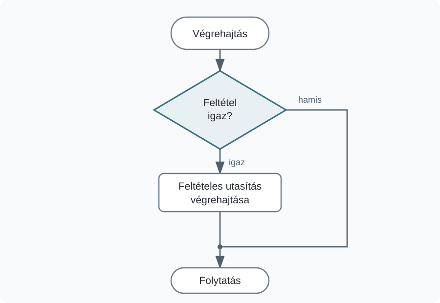
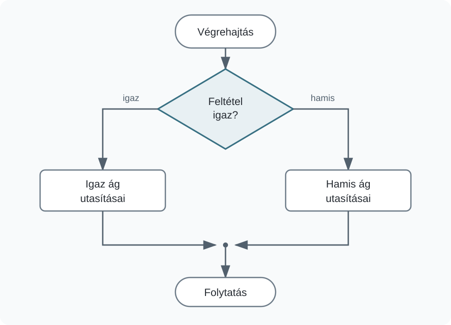
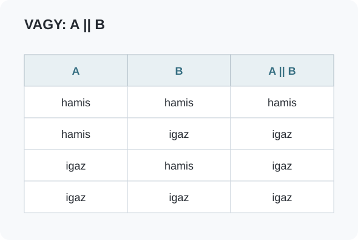
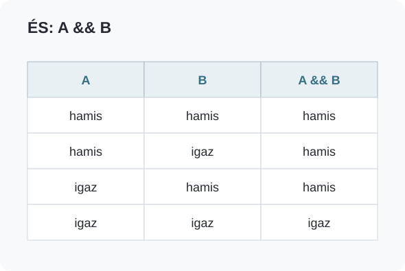
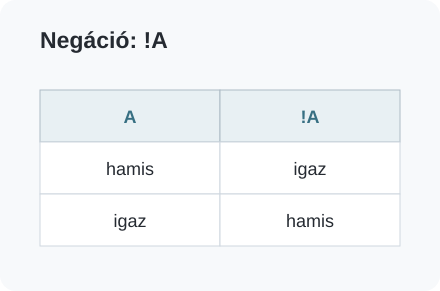

# Elágazások

## Feltételes végrehajtás {#felteteles-vegrehajtas}

Az eddigi programokban a `draw()` minden lefutásakor ugyanaz az utasítássor hajtódott végre. Az egyes értékek változhattak, például az egér helyzetétől függően, de a program nem választott különböző végrehajtási lehetőségek között.

Az **elágazás** segítségével egy vagy több utasítás végrehajtását feltételhez köthetjük. A feltétel eredménye logikai érték: igaz (`true`) vagy hamis (`false`). Ha például azt vizsgáljuk, hogy `mouseX > width / 2`, akkor arra kérdezünk rá, hogy az egér a rajzfelület jobb felén található-e.

A fejezet példái továbbra is egyszerű geometrikus kompozíciókból indulnak ki. A cél az, hogy a már ismert grafikus elemek viselkedését feltételekkel módosítsuk.

:::processing-example title="Kiinduló kompozíció" image="media/alapkompozicio.webp"
```processing
void setup() {
  size(700, 450);
}

void draw() {
  background(18, 24, 38);

  noStroke();
  fill(232, 235, 225);
  rect(80, 70, 155, 295);

  stroke(92, 116, 155);
  strokeWeight(5);
  line(60, 345, 630, 90);

  noStroke();
  fill(63, 132, 205);
  circle(340, 210, 210);

  fill(185, 70, 108);
  circle(525, 125, 110);

  fill(77, 185, 148);
  circle(548, 318, 65);
}
```
:::

## Az if utasítás {#if}

Az `if` utasítást akkor használjuk, ha egy utasítást vagy utasításcsoportot csak egy feltétel teljesülése esetén szeretnénk végrehajtani.

A következő szabályt valósítjuk meg: **ha az egér a rajzfelület jobb felén van, jelenjen meg egy sárga vízszintes sáv.**

```processing
if (mouseX > width / 2) {
  fill(250, 222, 70);
  rect(285, 188, 335, 27);
}
```

A feltétel a kerek zárójelek közé kerül. A kapcsos zárójelek között álló utasítások csak akkor hajtódnak végre, ha a feltétel igaz. Ha a feltétel hamis, ez a blokk kimarad, és a program a következő utasítással folytatódik.



:::processing-example title="Feltételesen megjelenő grafikus elem" image="media/if-akcent.webp"
```processing
void setup() {
  size(700, 450);
}

void draw() {
  background(18, 24, 38);

  noStroke();
  fill(63, 132, 205);
  circle(340, 210, 210);

  if (mouseX > width / 2) {
    fill(250, 222, 70);
    rect(285, 188, 335, 27);
  }
}
```

Az `if` ebben a példában egy elemet csak a feltétel igaz értéke esetén rajzol ki.
:::

## Numerikus összehasonlítások {#osszehasonlitasok}

A feltételek gyakran számok összehasonlításából származnak. A `<` és `>` operátorok azt vizsgálják, hogy az egyik érték kisebb vagy nagyobb-e a másiknál. A `<=` és `>=` a kisebb vagy egyenlő, illetve nagyobb vagy egyenlő kapcsolatot fejezi ki. Az `==` két érték egyenlőségét, a `!=` pedig különbözőségét vizsgálja.

Az `=` és a `==` szerepe eltér. Az `x = 100` értéket ad az `x` változónak. Az `x == 100` ezzel szemben egy logikai kifejezés, amelynek eredménye igaz vagy hamis.

Néhány egyszerű példa:

`mouseX < 100` — az egér a rajzfelület bal széléhez közel található.

`mouseY >= height / 2` — az egér a rajzfelület alsó felén található.

`x != 0` — az `x` változó értéke nem nulla.

## Kétágú elágazás: if–else {#if-else}

Az `if–else` szerkezet két egymást kizáró lehetőség közül választ. Az `if` ága akkor hajtódik végre, ha a feltétel igaz, az `else` ága pedig akkor, ha a feltétel hamis.

A következő példában az egér helyétől függően **nem ugyanazt az alakzatot rajzoljuk ki**. A rajzfelület bal oldalán kék téglalap, a jobb oldalán narancssárga kör jelenik meg.



:::processing-example title="Két különböző végrehajtási lehetőség" image="media/if-else-alakzat.webp"
```processing
void setup() {
  size(700, 450);
  rectMode(CENTER);
}

void draw() {
  background(18, 24, 38);

  noStroke();

  if (mouseX < width / 2) {
    fill(63, 132, 205);
    rect(340, 215, 140, 140);
  } else {
    fill(226, 99, 61);
    circle(340, 215, 140);
  }
}
```

Az `if` és az `else` ágban eltérő utasítások szerepelnek, ezért a feltétel a megjelenő alakzat típusát is meghatározza.
:::

## Logikai kifejezések összekapcsolása {#logikai-kifejezesek}

Egy összetettebb feltétel több egyszerű logikai kifejezésből is felépülhet. A Processingben a legfontosabb logikai operátorok a **negáció** (`!`), az **ÉS** (`&&`) és a **VAGY** (`||`).

### VAGY kapcsolat: || {#vagy}

A VAGY kapcsolat eredménye akkor igaz, ha legalább az egyik részkifejezés igaz.

A következő animált alakzat mérete folyamatosan változik. Akkor kell megfordítanunk a változás irányát, ha az alakzat elérte a maximális méretet **vagy** visszacsökkent a minimális méretig.

```processing
if (shapeSize >= shapeSizeMax || shapeSize <= shapeSizeMin) {
  shapeSizeDiff = -shapeSizeDiff;
}
```

A két összehasonlítás közül bármelyik elegendő ahhoz, hogy az `if` blokk végrehajtódjon.



:::processing-example title="Méretváltozás két határ között" image="media/or-novekvo.webp"
```processing
float shapeSize = 100;
float shapeSizeMin = 55;
float shapeSizeMax = 155;
float shapeSizeDiff = 2;

void setup() {
  size(700, 450);
}

void draw() {
  background(18, 24, 38);

  if (shapeSize >= shapeSizeMax || shapeSize <= shapeSizeMin) {
    shapeSizeDiff = -shapeSizeDiff;
  }

  shapeSize = shapeSize + shapeSizeDiff;

  noStroke();
  fill(63, 132, 205);
  circle(340, 220, shapeSize);
}
```
:::

### ÉS kapcsolat: && {#es}

Az ÉS kapcsolat eredménye csak akkor igaz, ha minden összekapcsolt feltétel igaz.

Tegyük fel, hogy azt szeretnénk eldönteni, hogy az egér egy téglalap belsejében található-e. Az egér `x` koordinátájának a téglalap bal és jobb széle közé, a `y` koordinátájának pedig a felső és alsó széle közé kell esnie.

```processing
if (mouseX >= 285 && mouseX <= 455 &&
    mouseY >= 145 && mouseY <= 305) {
  fill(250, 222, 70);
}
```



:::processing-example title="Egy téglalap területének érzékelése" image="media/and-terulet.webp"
```processing
void setup() {
  size(700, 450);
}

void draw() {
  background(18, 24, 38);

  noStroke();
  fill(63, 132, 205);

  if (mouseX >= 285 && mouseX <= 455 &&
      mouseY >= 145 && mouseY <= 305) {
    fill(250, 222, 70);
  }

  rect(285, 145, 170, 160);
}
```

A kiemelés csak akkor történik meg, ha mind a négy összehasonlítás egyszerre igaz.
:::

### Negáció: ! {#negacio}

A negáció egy logikai értéket az ellenkezőjére változtat. Ha egy kifejezés igaz, a negációja hamis; ha hamis, a negációja igaz.

A `mousePressed` beépített logikai változó azt jelzi, hogy van-e éppen lenyomva egérgomb. Ezért a `!mousePressed` kifejezés akkor igaz, amikor nincs lenyomva egérgomb.

```processing
if (!mousePressed) {
  circle(340, 215, 250);
}
```



## Logikai változók és egéresemények {#egeresemenyek}

A `boolean` típusú változó két értéket vehet fel: `true` vagy `false`. Ezzel egyszerűen tárolhatjuk egy állapot fennállását.

A következő példában az `isGrabbed` változó azt jegyzi meg, hogy az egérrel éppen megfogtuk-e a téglalapot.

```processing
boolean isGrabbed = false;
```

A Processing az egér műveleteihez külön eseménykezelő metódusokat biztosít. A `mousePressed()` akkor hajtódik végre, amikor lenyomjuk az egérgombot, a `mouseReleased()` felengedéskor, a `mouseDragged()` pedig akkor, amikor lenyomott egérgomb mellett mozgatjuk az egeret.

Ezeket a metódusokat nem nekünk kell meghívni. A Processing automatikusan végrehajtja őket a megfelelő egéresemény bekövetkezésekor.

:::processing-example title="Egy grafikus elem mozgatása egérrel" image="media/teglalap-huzas-szines.webp"
```processing
int x = 95;
int y = 140;
int rectWidth = 170;
int rectHeight = 145;

int dx = 0;
int dy = 0;

boolean isGrabbed = false;

void setup() {
  size(700, 450);
}

void draw() {
  background(18, 24, 38);

  stroke(250, 222, 70);
  strokeWeight(4);
  fill(63, 132, 205);
  rect(x, y, rectWidth, rectHeight);
}

void mousePressed() {
  if (x <= mouseX && mouseX <= x + rectWidth &&
      y <= mouseY && mouseY <= y + rectHeight) {
    isGrabbed = true;

    dx = mouseX - x;
    dy = mouseY - y;
  }
}

void mouseReleased() {
  isGrabbed = false;
}

void mouseDragged() {
  if (isGrabbed) {
    x = mouseX - dx;
    y = mouseY - dy;
  }
}
```

A `dx` és a `dy` azt tárolja, hogy a téglalapot a bal felső sarkához képest hol fogtuk meg. Ennek köszönhetően a téglalap húzás közben nem ugrik úgy, hogy a bal felső sarka kerüljön az egér helyére.
:::

Az eseménykezelésnél azt is megvizsgálhatjuk, melyik egérgombot használtuk. A `mouseButton` beépített változó ezt az információt tárolja. A bal egérgombot a `LEFT` értékkel hasonlíthatjuk össze.

```processing
if (mouseButton == LEFT) {
  // A bal egérgombhoz tartozó utasítások.
}
```

## Véletlen értékek {#random}

A záró példában szükségünk lesz arra, hogy a körök helye, mérete és színe ne legyen minden futtatáskor pontosan ugyanaz. Erre használható a Processing `random()` metódusa.

A `random(40, 100)` egy 40 és 100 közötti véletlen `float` értéket ad vissza. Ha csak egy felső határt adunk meg, például `random(width)`, akkor az eredmény 0 és `width` közé esik.

:::processing-example title="Véletlen méretű és színű körök" image="media/random-korok.webp"
```processing
void setup() {
  size(700, 450);
  background(10, 18, 32);
}

void draw() {
}

void mousePressed() {
  if (mouseButton == LEFT) {
    float diameter = random(38, 100);

    if (mouseX < width / 2) {
      fill(random(45, 125),
           random(120, 220),
           random(165, 255));
    } else {
      fill(random(190, 255),
           random(70, 175),
           random(40, 135));
    }

    circle(mouseX, mouseY, diameter);
  }
}
```

Mivel a hátteret csak a `setup()` metódusban rajzoljuk meg, a korábban létrehozott körök megmaradnak.
:::

## Összetett példa: geometrikus körkompozíció {#osszefoglalo-pelda}

Wassily Kandinsky **Several Circles** című, 1926-os festménye sötét háttéren különböző méretű és színű körökből épül fel. A következő példában nem a festmény pontos másolatát készítjük el, hanem a kompozíció néhány egyszerű szerkezeti tulajdonságát használjuk kiindulópontként.


A festmény reprodukciójának forrása a [Wikimedia Commons](https://commons.wikimedia.org/wiki/File:Vassily_Kandinsky,_1926_-_Several_Circles,_Gugg_0910_25.jpg).

A kép programozási szempontból egyszerű elemekre bontható: sötét háttérre, néhány nagyobb meghatározó körre, több kisebb körre és néhány vonalra. A kisebb elemek helyét, méretét és színét véletlen értékekből állítjuk elő.

### A kompozíció meghatározó elemei {#kandinsky-alap}

Először néhány nagyobb elemet helyezünk el kézzel. Ezek adják a kép alapvető szerkezetét.

```processing
background(10, 18, 32);

stroke(45, 95, 240);
strokeWeight(28);
fill(20, 35, 90);
circle(315, 242, 340);

noStroke();
fill(8, 10, 18);
circle(304, 231, 232);

stroke(70, 80, 95);
strokeWeight(2);
fill(225, 225, 235);
circle(570, 330, 160);
```

### Tíz véletlen kör {#kandinsky-korok}

A további köröknél minden alkalommal véletlen helyet és átmérőt állítunk elő. A kör színét egy elágazás is befolyásolja: a rajzfelület bal oldalán hidegebb, a jobb oldalán melegebb színtartományból választunk.

Az alábbi utasítássort tízszer írjuk le. **Ciklust még nem használunk**, ezért az ismétlés szándékosan látható a kódban.

:::processing-example title="Egy lehetséges véletlenszerű kompozíció" image="media/kandinsky-sajat-10.webp"
```processing
float x;
float y;
float diameter;

void setup() {
  size(700, 450);
  background(10, 18, 32);

  // Meghatározó elemek
  stroke(45, 95, 240);
  strokeWeight(28);
  fill(20, 35, 90);
  circle(315, 242, 340);

  noStroke();
  fill(8, 10, 18);
  circle(304, 231, 232);

  stroke(70, 80, 95);
  strokeWeight(2);
  fill(225, 225, 235);
  circle(570, 330, 160);

  noStroke();

  // 1. kör
  x = random(width);
  y = random(height);
  diameter = random(25, 115);

  if (x < width / 2) {
    fill(random(40, 135),
         random(110, 225),
         random(160, 255));
  } else {
    fill(random(185, 255),
         random(65, 185),
         random(35, 145));
  }

  circle(x, y, diameter);

  // 2. kör
  x = random(width);
  y = random(height);
  diameter = random(25, 115);

  if (x < width / 2) {
    fill(random(40, 135),
         random(110, 225),
         random(160, 255));
  } else {
    fill(random(185, 255),
         random(65, 185),
         random(35, 145));
  }

  circle(x, y, diameter);

  // 3. kör
  x = random(width);
  y = random(height);
  diameter = random(25, 115);

  if (x < width / 2) {
    fill(random(40, 135),
         random(110, 225),
         random(160, 255));
  } else {
    fill(random(185, 255),
         random(65, 185),
         random(35, 145));
  }

  circle(x, y, diameter);

  // 4. kör
  x = random(width);
  y = random(height);
  diameter = random(25, 115);

  if (x < width / 2) {
    fill(random(40, 135),
         random(110, 225),
         random(160, 255));
  } else {
    fill(random(185, 255),
         random(65, 185),
         random(35, 145));
  }

  circle(x, y, diameter);

  // 5. kör
  x = random(width);
  y = random(height);
  diameter = random(25, 115);

  if (x < width / 2) {
    fill(random(40, 135),
         random(110, 225),
         random(160, 255));
  } else {
    fill(random(185, 255),
         random(65, 185),
         random(35, 145));
  }

  circle(x, y, diameter);

  // 6. kör
  x = random(width);
  y = random(height);
  diameter = random(25, 115);

  if (x < width / 2) {
    fill(random(40, 135),
         random(110, 225),
         random(160, 255));
  } else {
    fill(random(185, 255),
         random(65, 185),
         random(35, 145));
  }

  circle(x, y, diameter);

  // 7. kör
  x = random(width);
  y = random(height);
  diameter = random(25, 115);

  if (x < width / 2) {
    fill(random(40, 135),
         random(110, 225),
         random(160, 255));
  } else {
    fill(random(185, 255),
         random(65, 185),
         random(35, 145));
  }

  circle(x, y, diameter);

  // 8. kör
  x = random(width);
  y = random(height);
  diameter = random(25, 115);

  if (x < width / 2) {
    fill(random(40, 135),
         random(110, 225),
         random(160, 255));
  } else {
    fill(random(185, 255),
         random(65, 185),
         random(35, 145));
  }

  circle(x, y, diameter);

  // 9. kör
  x = random(width);
  y = random(height);
  diameter = random(25, 115);

  if (x < width / 2) {
    fill(random(40, 135),
         random(110, 225),
         random(160, 255));
  } else {
    fill(random(185, 255),
         random(65, 185),
         random(35, 145));
  }

  circle(x, y, diameter);

  // 10. kör
  x = random(width);
  y = random(height);
  diameter = random(25, 115);

  if (x < width / 2) {
    fill(random(40, 135),
         random(110, 225),
         random(160, 255));
  } else {
    fill(random(185, 255),
         random(65, 185),
         random(35, 145));
  }

  circle(x, y, diameter);

  // 1. vonal
  stroke(random(95, 225), random(95, 225), random(95, 225));
  strokeWeight(random(1, 4));
  line(random(width), random(height), random(width), random(height));

  // 2. vonal
  stroke(random(95, 225), random(95, 225), random(95, 225));
  strokeWeight(random(1, 4));
  line(random(width), random(height), random(width), random(height));

  // 3. vonal
  stroke(random(95, 225), random(95, 225), random(95, 225));
  strokeWeight(random(1, 4));
  line(random(width), random(height), random(width), random(height));

  // 4. vonal
  stroke(random(95, 225), random(95, 225), random(95, 225));
  strokeWeight(random(1, 4));
  line(random(width), random(height), random(width), random(height));

}

void draw() {
}
```

A `random()` miatt a pontos eredmény minden futtatáskor más lesz. A képen egy lehetséges változat látható.
:::

A körök létrehozásánál tízszer, a vonalaknál pedig négyszer ismételtünk nagyon hasonló utasításokat. Ez már jól mutatja az ilyen megoldás hátrányát: a program hosszú lesz, és egy közös módosítást több helyen is el kell végezni.

A következő fejezetben a **ciklusok** segítségével ugyanezt az ismétlődő műveletet lényegesen rövidebben tudjuk majd leírni.

### A kompozíció további alakítása {#kandinsky-interakcio}

Az eseménykezelést is felhasználhatjuk. Bal kattintáskor új, véletlen méretű kör kerül a kattintás helyére.

:::processing-example title="Új körök hozzáadása kattintással" image="media/kandinsky-kattintas-10.webp"
```processing
void mousePressed() {
  if (mouseButton == LEFT) {
    float newDiameter = random(30, 85);

    noStroke();

    if (mouseX < width / 2) {
      fill(random(40, 135),
           random(110, 225),
           random(160, 255));
    } else {
      fill(random(185, 255),
           random(65, 185),
           random(35, 145));
    }

    circle(mouseX, mouseY, newDiameter);
  }
}
```
:::

A záró példa az eddig használt elemeket kapcsolja össze: változókat, numerikus és összetett feltételeket, `if–else` elágazást, eseménykezelést és véletlen értékeket. Új programozási szerkezetet nem vezet be.
