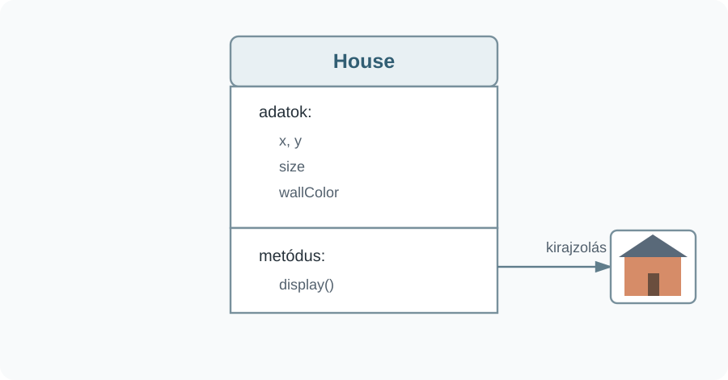

# Metódusok és összetett adatszerkezetek

## Saját metódusok {#sajat-metodusok}

Egy összetettebb grafikus elem több egyszerű primitívből épülhet fel. A következő ház falát és ablakait téglalapokkal, a tetőt háromszöggel rajzoljuk meg.

:::processing-example title="Egy ház egyszerű grafikus elemekből" image="media/egy-haz.webp"
```processing
void setup() {
  size(700, 450);
  background(238, 241, 244);

  fill(210, 120, 85);
  rect(250, 190, 200, 144);

  fill(70, 80, 100);
  triangle(234, 190, 350, 106, 466, 190);

  fill(90, 65, 50);
  rect(334, 270, 38, 64);

  fill(180, 220, 235);
  rect(278, 226, 36, 36);
  rect(386, 226, 36, 36);
}
```
:::

A `triangle()` három csúcspont koordinátáit kapja meg:

`triangle(x1, y1, x2, y2, x3, y3)`

Ha ugyanezt a házat több helyen is szeretnénk megrajzolni, célszerű a rajzolás lépéseit saját metódusba szervezni. A metódus egy névvel ellátott utasítássor, amelyet a program több pontján is meghívhatunk.

```processing
void drawHouse() {
  // A ház rajzolásának utasításai.
}
```

A `void` azt jelzi, hogy a metódus nem ad vissza értéket. A `setup()` és a `draw()` is metódus, ezeket azonban a Processing hívja meg automatikusan. A saját `drawHouse()` metódust ott hívjuk meg, ahol a házat meg szeretnénk jeleníteni:

```processing
drawHouse();
```

## Paraméterek és visszatérési érték {#parameterek}

Egy paraméter nélküli `drawHouse()` minden meghíváskor ugyanazt a rajzot készítené ugyanazon a helyen. A metódus általánosabban használható, ha a változó adatokat paraméterként kapja meg.

A következő változat a ház helyét, méretét és falszínét paraméterként használja:

```processing
void drawHouse(float x, float y,
               float size, color wallColor) {
  float wallHeight = size * 0.72;
  float roofHeight = size * 0.42;

  fill(wallColor);
  rect(x, y, size, wallHeight);

  fill(70, 80, 100);
  triangle(x - size * 0.08, y,
           x + size * 0.5, y - roofHeight,
           x + size * 1.08, y);

  fill(90, 65, 50);
  rect(x + size * 0.42,
       y + size * 0.40,
       size * 0.19,
       wallHeight * 0.60);

  fill(180, 220, 235);
  rect(x + size * 0.14,
       y + size * 0.18,
       size * 0.18,
       size * 0.18);

  rect(x + size * 0.68,
       y + size * 0.18,
       size * 0.18,
       size * 0.18);
}
```

A `color` Processing-adattípus egy színt tárol. A `color(215, 125, 85)` például egy RGB-színt állít elő, amelyet változóban vagy paraméterként is használhatunk.

:::processing-example title="Ugyanaz a metódus különböző paraméterekkel" image="media/harom-haz.webp"
```processing
void setup() {
  size(700, 450);
  background(222, 232, 242);

  drawHouse(70, 248, 125,
            color(215, 125, 85));
  drawHouse(270, 226, 155,
            color(190, 145, 95));
  drawHouse(500, 262, 105,
            color(210, 100, 100));
}
```
:::

A paraméterek a metódus definíciójában szereplő változók; a meghíváskor megadott konkrét értékeket argumentumoknak nevezzük. A három hívás ugyanazt a rajzolási algoritmust használja, de eltérő adatokkal.

A metódus nemcsak utasításokat hajthat végre, hanem értéket is visszaadhat. Ilyenkor a `void` helyett a visszatérési érték típusát adjuk meg. Például:

```processing
float getWallHeight(float size) {
  return size * 0.72;
}
```

A metódus eredménye felhasználható egy kifejezésben vagy eltárolható változóban:

```processing
float wallHeight = getWallHeight(125);
```

A későbbi fejezetben olyan metódust is használunk, amely `boolean` értéket ad vissza; ennek eredménye közvetlenül felhasználható egy feltételben.

## Osztály mint összetett adattípus {#class}

Egy házhoz több adat tartozik: a helye, mérete és színe. Egyetlen háznál ezek külön változókban is tárolhatók:

```processing
float houseX = 70;
float houseY = 230;
float houseSize = 125;
color houseColor = color(215, 125, 85);
```

Több ház esetén azonban ugyanazok az adatok ismétlődnek minden példánynál. Az összetartozó értékeket saját adattípusba szervezhetjük. Erre szolgál a `class`.

```processing
class House {
  float x;
  float y;
  float size;
  color wallColor;
}
```

A `House` egy általunk létrehozott típus. Az `x`, `y`, `size` és `wallColor` mezők együtt írják le egy ház állapotát.



**Konstruktor.** Új objektum létrehozásakor kezdeti értékeket kell adnunk a mezőknek. Ezt végzi a konstruktor, amelynek neve megegyezik az osztály nevével:

```processing
House(float px, float py,
      float pSize, color pWallColor) {
  x = px;
  y = py;
  size = pSize;
  wallColor = pWallColor;
}
```

Egy konkrét objektum a `new` kulcsszóval hozható létre:

```processing
House house1 =
  new House(70, 230, 125,
            color(215, 125, 85));
```

A `house1` egy `House` típusú objektum, amely a négy adatot együtt tárolja.

**Metódus az osztályban.** Az osztályhoz az adatokkal végzett műveletek is hozzárendelhetők. A ház megjelenítését például `display()` metódusba tehetjük:

```processing
void display() {
  float wallHeight = size * 0.72;
  float roofHeight = size * 0.42;

  fill(wallColor);
  rect(x, y, size, wallHeight);

  fill(70, 80, 100);
  triangle(x - size * 0.08, y,
           x + size * 0.5, y - roofHeight,
           x + size * 1.08, y);

  // ajtó és ablakok...
}
```

A metódus az objektum saját mezőit közvetlenül eléri, ezért az `x`, `y`, `size` és `wallColor` értékeket nem kell minden meghíváskor újra átadni. A meghívás az objektumon keresztül történik:

```processing
house1.display();
```

## Objektumok használata {#objektumok}

Ugyanabból az osztályból több különböző objektum hozható létre. Minden objektumnak saját mezőértékei vannak, miközben ugyanazokat a metódusokat használja.

:::processing-example title="Több House objektumból felépített jelenet" image="media/haz-objektumok.webp"
```processing
House house1;
House house2;
House house3;
House house4;

void setup() {
  size(700, 450);

  house1 = new House(55, 248, 125,
                     color(222, 130, 90));
  house2 = new House(225, 226, 155,
                     color(187, 150, 100));
  house3 = new House(440, 244, 130,
                     color(204, 105, 112));
  house4 = new House(590, 273, 90,
                     color(174, 138, 175));
}

void draw() {
  background(207, 225, 242);

  noStroke();
  fill(246, 205, 82);
  circle(605, 90, 70);

  fill(184, 207, 172);
  rect(0, 338, width, height - 338);

  house1.display();
  house2.display();
  house3.display();
  house4.display();
}

class House {
  float x;
  float y;
  float size;
  color wallColor;

  House(float px, float py,
        float pSize, color pWallColor) {
    x = px;
    y = py;
    size = pSize;
    wallColor = pWallColor;
  }

  void display() {
    float wallHeight = size * 0.72;
    float roofHeight = size * 0.42;

    noStroke();

    fill(wallColor);
    rect(x, y, size, wallHeight);

    fill(70, 80, 100);
    triangle(x - size * 0.08, y,
             x + size * 0.5, y - roofHeight,
             x + size * 1.08, y);

    fill(90, 65, 50);
    rect(x + size * 0.42,
         y + size * 0.40,
         size * 0.19,
         wallHeight * 0.60);

    fill(180, 220, 235);
    rect(x + size * 0.14,
         y + size * 0.18,
         size * 0.18,
         size * 0.18);

    rect(x + size * 0.68,
         y + size * 0.18,
         size * 0.18,
         size * 0.18);
  }
}
```
:::

Az osztály ebben a példában elsősorban összetett adattípusként szolgál: egy házhoz tartozó adatokat és a ház megjelenítését egyetlen szerkezetben fogja össze. A későbbi példákban ugyanez a megközelítés összetettebb grafikus elemeknél is alkalmazható.
