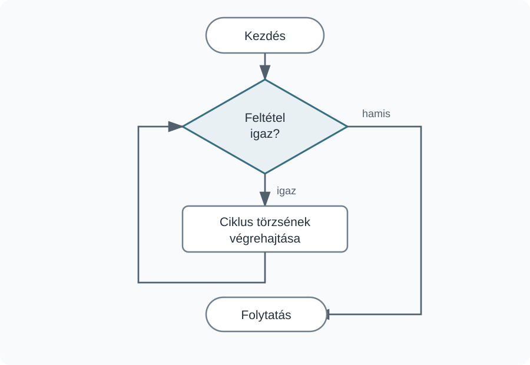
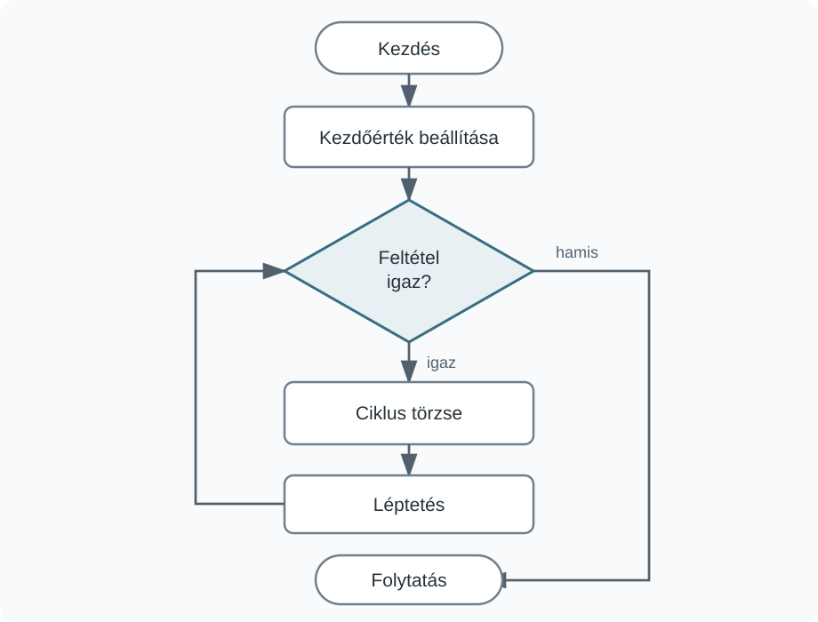
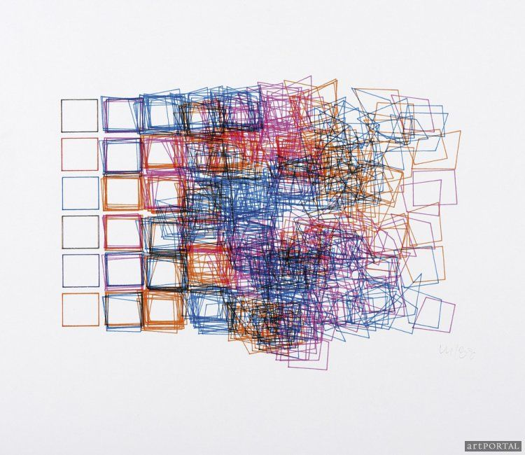
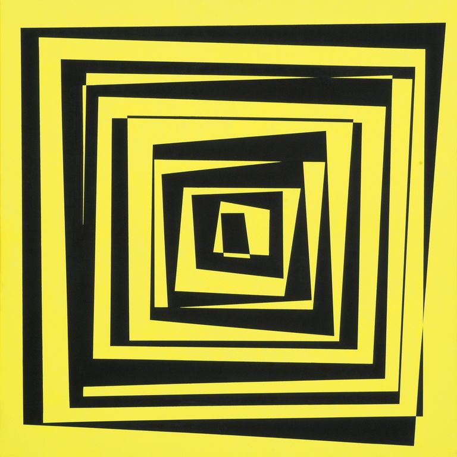
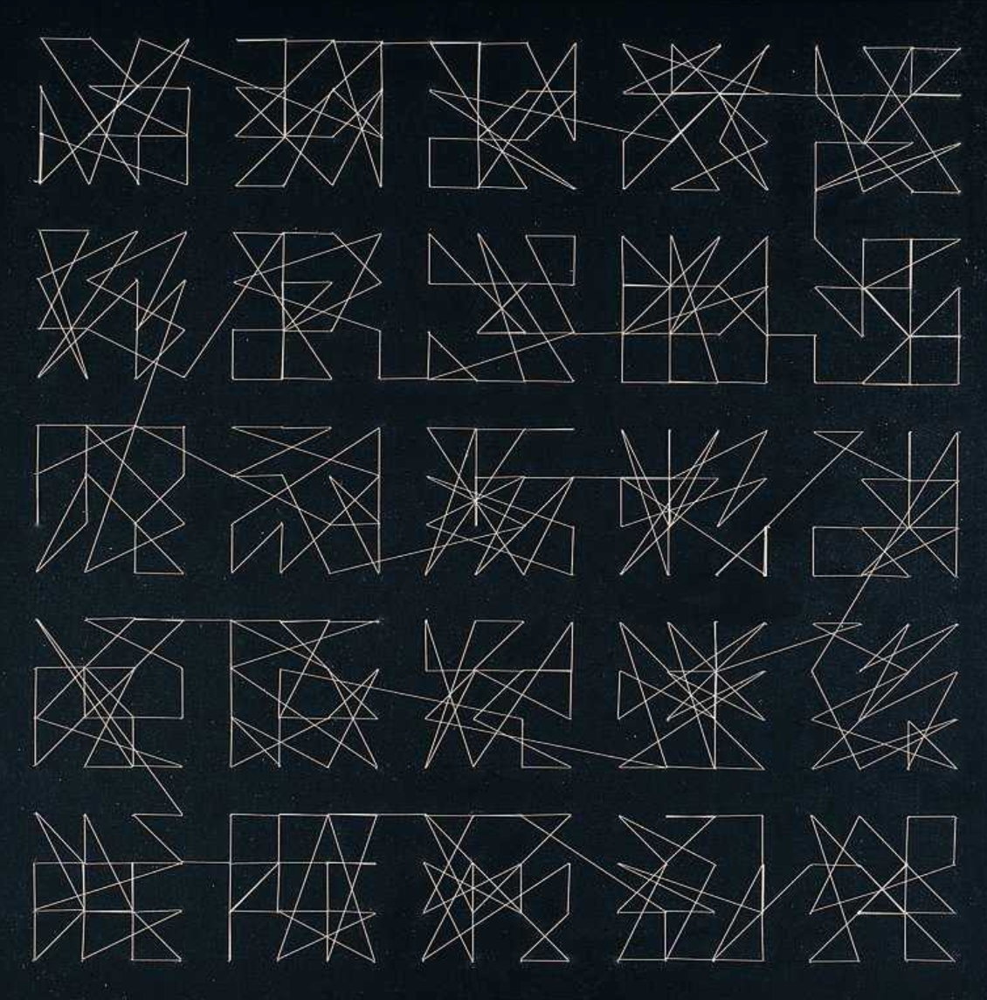

# Ciklusok

Az ismétlődő műveleteket saját metódusokkal már egyszer le tudjuk írni, de a metódus meghívása továbbra is ismétlődhet. A ciklus egy utasítás vagy utasításcsoport ismételt végrehajtását írja le. Ebben a fejezetben a `while` és a `for` ciklust használjuk.

## A while ciklus {#while}

A `while` ciklus addig hajtja végre a törzsében lévő utasításokat, amíg a feltétele igaz.

```processing
while (feltétel) {
  // ismétlődő utasítások
}
```

A feltételt minden ismétlés előtt megvizsgáljuk. Ha igaz, a ciklus törzse végrehajtódik, majd a program ismét a feltételhez tér vissza. Hamis feltétel esetén a ciklus befejeződik.



A ciklus törzsében olyan változásnak kell történnie, amely lehetővé teszi, hogy a feltétel később hamissá váljon. Ellenkező esetben a program végtelen ciklusba kerülhet.

**Véletlen méretű körök egy sorban.** A következő program balról jobbra haladva köröket rajzol. A kör átmérője és a következő kör előtti távolság minden ismétlésben véletlen értéket kap. Emiatt a program megírásakor nem tudjuk előre, hogy a ciklus pontosan hányszor fog lefutni; a ciklus akkor áll meg, amikor az `x` koordináta eléri a rajzfelület jobb szélét.

:::processing-example title="While ciklus véletlen méretű elemekkel" image="media/while-korlanc.webp"
```processing
void setup() {
  size(700, 450);
  background(18, 24, 38);

  float x = 18;

  while (x < width) {
    float diameter = random(28, 72);
    float gap = random(6, 22);

    fill(random(60, 235),
         random(80, 210),
         random(100, 245));

    circle(x + diameter / 2,
           height / 2,
           diameter);

    x = x + diameter + gap;
  }
}
```
:::

## A for ciklus {#for}

Ha az ismétlés egy számlálóval egyszerűen leírható, a `for` ciklus általában tömörebb szerkezetet ad.

```processing
for (kezdőérték; feltétel; léptetés) {
  // ismétlődő utasítások
}
```

Egy tízszer lefutó ciklus:

```processing
for (int i = 0; i < 10; i++) {
  // ismétlődő utasítások
}
```

Az `int i = 0` létrehozza a ciklusváltozót és beállítja a kezdőértékét. Az `i < 10` a folytatás feltétele. Az `i++` minden ismétlés végén eggyel növeli az `i` értékét; ugyanazt jelenti, mint az `i = i + 1`.



A ciklusváltozó nemcsak az ismétlések számát adhatja meg. Felhasználható az egyes elemek helyének, méretének vagy színének kiszámítására is.

:::processing-example title="Tíz sáv egy for ciklussal" image="media/for-savok.webp"
```processing
void setup() {
  size(700, 450);
  background(245);

  int numberOfRects = 10;
  float gap = 10;
  float margin = 30;

  float rectWidth =
    (width - 2 * margin -
     (numberOfRects - 1) * gap)
    / numberOfRects;

  noStroke();

  for (int i = 0; i < numberOfRects; i++) {
    float x =
      margin + i * (rectWidth + gap);

    fill(35 + i * 19,
         90 + i * 10,
         210 - i * 10);

    rect(x, 55, rectWidth, 340);
  }
}
```
:::

## A Kandinsky-példa megoldása for ciklussal {#kandinsky-for}

Az előző fejezetben a `drawRandomCircle()` és a `drawRandomLine()` metódusokkal a rajzolási algoritmust már kiszerveztük, de a metódushívásokat több alkalommal egymás után kellett leírni. A ciklus ezt az ismétlést helyettesíti.

Most már nem tíz, hanem negyven kört és tizenkét vonalat készítünk; a program hossza ettől nem nő lényegesen.

:::processing-example title="Kandinsky-jellegű kompozíció ciklusokkal" image="media/for-kandinsky.webp"
```processing
void setup() {
  size(800, 600);
  background(10, 18, 32);

  blendMode(SCREEN);

  for (int i = 0; i < 40; i++) {
    drawRandomCircle(
      random(width),
      random(height)
    );
  }

  for (int i = 0; i < 12; i++) {
    drawRandomLine();
  }
}

void drawRandomCircle(float x, float y) {
  float diameter = random(18, 105);

  noStroke();

  if (x < width / 2) {
    fill(random(40, 135),
         random(110, 225),
         random(160, 255));
  } else {
    fill(random(185, 255),
         random(65, 185),
         random(35, 145));
  }

  circle(x, y, diameter);
}

void drawRandomLine() {
  stroke(random(95, 230),
         random(95, 230),
         random(95, 230));

  strokeWeight(random(1, 3));

  line(random(width), random(height),
       random(width), random(height));
}
```
:::

A metódus azt írja le, hogyan készül egy elem; a ciklus azt, hogy hányszor hajtsuk végre ugyanazt a műveletet.

## Egymásba ágyazott ciklusok {#egymasba-agyazott}

Sorokból és oszlopokból álló struktúra két egymásba ágyazott ciklussal írható le. A külső ciklus a sorokon, a belső ciklus az adott sor oszlopain halad végig.

:::processing-example title="Színes rács két ciklussal" image="media/ciklus-racs.webp"
```processing
void setup() {
  size(700, 450);
  background(245);

  int rows = 6;
  int cols = 10;

  float gap = 6;
  float marginX = 45;
  float marginY = 55;

  float cellWidth =
    (width - 2 * marginX -
     (cols - 1) * gap) / cols;

  float cellHeight =
    (height - 2 * marginY -
     (rows - 1) * gap) / rows;

  noStroke();

  for (int row = 0; row < rows; row++) {
    for (int col = 0; col < cols; col++) {
      float x =
        marginX +
        col * (cellWidth + gap);

      float y =
        marginY +
        row * (cellHeight + gap);

      fill(45 + col * 17,
           70 + row * 25,
           190 - (row + col) * 5);

      rect(x, y, cellWidth, cellHeight);
    }
  }
}
```
:::

Egy adott `row` érték mellett a belső `col` ciklus végigfut az összes oszlopon. Ezután a külső ciklus a következő sorra lép, és a belső ciklus ismét elindul.

## Molnár Vera-példák {#molnar}

A fejezet végén három olyan kompozíciót nézünk meg, amelyekben a ciklusok már nem egyszerű ismétlésként, hanem összetettebb vizuális szabályok részeként jelennek meg. Mindhárom példát több lépésben építjük fel, hogy jól látható legyen, mit ad hozzá az adott módosítás.

### Molnár Vera: Structure de quadrilatères (1985) {#molnar-quadrilateres}

A **Structure de quadrilatères** több, rácsba rendezett négyszöget használ. A szabályos rácsszerkezet és a fokozatosan növekvő torzítás egyszerre van jelen.



Forrás: [Piasa – Vera Molnár, Structure de quadrilatères, 1985](https://www.piasa.fr/en/products/vera-molnar-nee-en-1924-structure-de-quadrilateres-1985_62178912c54e0497169305).

A kompozíció vonalrajzokra épül, ezért itt nincs szükség külön színkeverési módra. Enyhén törtfehér hátteret használunk. A négyszögek száma és torzítása az első hét oszlopban fokozatosan nő; ezután a példányszám csökken, miközben a torzítás nagy marad.

**1. változat – szabályos rács.** Először csak a kiinduló négyzetrácsot rajzoljuk meg.

:::processing-example title="Structure de quadrilatères – 1. változat" image="media/molnar-quad-v1.webp"
```processing
int rows = 6;
int cols = 10;

float squareSize = 72;
float horizontalGap = 12;
float verticalGap = 12;

void setup() {
  size(1000, 650);
  background(245, 243, 236);

  float totalWidth =
    cols * squareSize +
    (cols - 1) * horizontalGap;

  float totalHeight =
    rows * squareSize +
    (rows - 1) * verticalGap;

  float startX = (width - totalWidth) / 2;
  float startY = (height - totalHeight) / 2;

  stroke(95);
  noFill();

  for (int row = 0; row < rows; row++) {
    for (int col = 0; col < cols; col++) {
      float x =
        startX +
        col * (squareSize + horizontalGap);

      float y =
        startY +
        row * (squareSize + verticalGap);

      rect(x, y, squareSize, squareSize);
    }
  }
}
```
:::

**2. változat – oszloponként növekvő torzítás.** A négyzeteket négyszöggé torzítjuk. Jobbra haladva a sarkok egyre nagyobb mértékben mozdulnak el.

:::processing-example title="Structure de quadrilatères – 2. változat" image="media/molnar-quad-v2.webp"
```processing
int rows = 6;
int cols = 10;

float squareSize = 72;
float horizontalGap = 12;
float verticalGap = 12;

void setup() {
  size(1000, 650);
  background(245, 243, 236);

  float totalWidth =
    cols * squareSize +
    (cols - 1) * horizontalGap;

  float totalHeight =
    rows * squareSize +
    (rows - 1) * verticalGap;

  float startX = (width - totalWidth) / 2;
  float startY = (height - totalHeight) / 2;

  stroke(95);
  noFill();

  for (int row = 0; row < rows; row++) {
    for (int col = 0; col < cols; col++) {
      float x =
        startX +
        col * (squareSize + horizontalGap);

      float y =
        startY +
        row * (squareSize + verticalGap);

      float distortion = 1 + col * 4;

      drawDistortedSquare(
        x, y,
        squareSize,
        distortion
      );
    }
  }
}

void drawDistortedSquare(float x, float y,
                         float size,
                         float distortion) {
  float shiftX = random(-distortion, distortion);
  float shiftY = random(-distortion, distortion);
  float corner = distortion * 0.35;

  float x0 = x + shiftX + random(-corner, corner);
  float y0 = y + shiftY + random(-corner, corner);

  float x1 = x + size + shiftX + random(-corner, corner);
  float y1 = y + shiftY + random(-corner, corner);

  float x2 = x + size + shiftX + random(-corner, corner);
  float y2 = y + size + shiftY + random(-corner, corner);

  float x3 = x + shiftX + random(-corner, corner);
  float y3 = y + size + shiftY + random(-corner, corner);

  quad(x0, y0, x1, y1,
       x2, y2, x3, y3);
}
```
:::

**3. változat – több példány egy cellában.** Most már nemcsak a torzítás mértéke változik, hanem az egy cellára jutó négyszögek száma is. Az első hét oszlopban a példányszám nő, utána csökken.

:::processing-example title="Structure de quadrilatères – 3. változat" image="media/molnar-quad-v3.webp"
```processing
int rows = 6;
int cols = 10;

float squareSize = 72;
float horizontalGap = 12;
float verticalGap = 12;

void setup() {
  size(1000, 650);
  background(245, 243, 236);

  float totalWidth =
    cols * squareSize +
    (cols - 1) * horizontalGap;

  float totalHeight =
    rows * squareSize +
    (rows - 1) * verticalGap;

  float startX = (width - totalWidth) / 2;
  float startY = (height - totalHeight) / 2;

  stroke(85);
  noFill();

  for (int row = 0; row < rows; row++) {
    for (int col = 0; col < cols; col++) {
      float x =
        startX +
        col * (squareSize + horizontalGap);

      float y =
        startY +
        row * (squareSize + verticalGap);

      float distortion =
        1 + min(col, 6) * 4;

      int copies;

      if (col <= 6) {
        copies = 1 + col + col / 2;
      } else {
        copies = 10 - (col - 6) * 2;
      }

      for (int k = 0; k < copies; k++) {
        drawDistortedSquare(
          x, y,
          squareSize,
          distortion
        );
      }
    }
  }
}

void drawDistortedSquare(float x, float y,
                         float size,
                         float distortion) {
  float shiftX = random(-distortion, distortion);
  float shiftY = random(-distortion, distortion);
  float corner = distortion * 0.35;

  float x0 = x + shiftX + random(-corner, corner);
  float y0 = y + shiftY + random(-corner, corner);

  float x1 = x + size + shiftX + random(-corner, corner);
  float y1 = y + shiftY + random(-corner, corner);

  float x2 = x + size + shiftX + random(-corner, corner);
  float y2 = y + size + shiftY + random(-corner, corner);

  float x3 = x + shiftX + random(-corner, corner);
  float y3 = y + size + shiftY + random(-corner, corner);

  quad(x0, y0, x1, y1,
       x2, y2, x3, y3);
}
```
:::

**4. változat – színezett végső változat.** A végső képnél a vonalakat több színből választjuk.

:::processing-example title="Structure de quadrilatères – 4. változat" image="media/molnar-quad-v4.webp"
```processing
int rows = 6;
int cols = 10;

float squareSize = 72;
float horizontalGap = 12;
float verticalGap = 12;

void setup() {
  size(1000, 650);
  background(245, 243, 236);
  noFill();

  float totalWidth =
    cols * squareSize +
    (cols - 1) * horizontalGap;

  float totalHeight =
    rows * squareSize +
    (rows - 1) * verticalGap;

  float startX = (width - totalWidth) / 2;
  float startY = (height - totalHeight) / 2;

  for (int row = 0; row < rows; row++) {
    for (int col = 0; col < cols; col++) {
      float x =
        startX +
        col * (squareSize + horizontalGap);

      float y =
        startY +
        row * (squareSize + verticalGap);

      float distortion =
        1 + min(col, 6) * 4;

      int copies;

      if (col <= 6) {
        copies = 1 + col + col / 2;
      } else {
        copies = 10 - (col - 6) * 2;
      }

      for (int k = 0; k < copies; k++) {
        float choice = random(4);

        if (choice < 1) {
          stroke(33, 78, 133);
        } else if (choice < 2) {
          stroke(218, 101, 48);
        } else if (choice < 3) {
          stroke(166, 61, 132);
        } else {
          stroke(73, 89, 105);
        }

        drawDistortedSquare(
          x, y,
          squareSize,
          distortion
        );
      }
    }
  }
}
```
:::

### Molnár Vera: Transzformáció 15. (1975) {#molnar-transzformacio}

A **Transzformáció 15.** egymásba rendezett fekete és sárga négyszögsávokat használ. A reprodukció kompozíciója négyzetes jellegű, ezért a saját változatot is négyzetekből építjük fel.



A reprodukciót az Artmagazin a Szöllősi-Nagy–Nemes Gyűjteményből közölte.

A megoldás alapja ugyanaz marad, mint a korábbi változatban: minden rétegben először egy fekete négyszöget rajzolunk, majd erre egy valamivel kisebb sárga négyszöget. A két alakzat együtt adja a fekete keretet. A későbbi változatokban a sarkokhoz külön-külön kis véletlen eltérést adunk, így az egyes rétegek nem teljesen azonos módon torzulnak.

**1. változat – szabályos négyzetes keretek.** Először csak a négyzetes szerkezetet készítjük el.

:::processing-example title="Transzformáció 15. – 1. változat" image="media/transz-v1.webp"
```processing
void setup() {
  size(800, 600);
  background(248, 235, 65);
  noStroke();

  float baseSize = 500;
  float step = 48;

  for (int i = 0; i < 9; i++) {
    float side = baseSize - i * step;

    float x = width / 2 - side / 2;
    float y = height / 2 - side / 2;

    fill(18, 20, 19);
    rect(x, y, side, side);

    float innerSide = side - 32;
    float innerX = width / 2 - innerSide / 2;
    float innerY = height / 2 - innerSide / 2;

    fill(248, 235, 65);
    rect(innerX, innerY, innerSide, innerSide);
  }
}
```
:::

**2. változat – a rétegek külön torzulnak.** A `quad()` használatával mind a négy sarokhoz külön véletlen eltérést adunk. A fekete külső és a sárga belső négyszög is önállóan kap eltéréseket.

:::processing-example title="Transzformáció 15. – 2. változat" image="media/transz-v2.webp"
```processing
void setup() {
  size(800, 600);
  background(248, 235, 65);
  noStroke();

  float baseSize = 500;
  float step = 48;

  for (int i = 0; i < 9; i++) {
    float side = baseSize - i * step;
    float distortion = 2 + i * 0.6;

    drawRandomLayer(
      side,
      16,
      distortion
    );
  }
}

void drawRandomLayer(float side,
                     float frameWidth,
                     float distortion) {
  drawRandomQuad(
    side,
    distortion,
    color(18, 20, 19)
  );

  drawRandomQuad(
    side - 2 * frameWidth,
    distortion * 0.7,
    color(248, 235, 65)
  );
}

void drawRandomQuad(float side,
                    float distortion,
                    color c) {
  float left = width / 2 - side / 2;
  float right = width / 2 + side / 2;
  float top = height / 2 - side / 2;
  float bottom = height / 2 + side / 2;

  fill(c);

  quad(
    left + random(-distortion, distortion),
    top + random(-distortion, distortion),

    right + random(-distortion, distortion),
    top + random(-distortion, distortion),

    right + random(-distortion, distortion),
    bottom + random(-distortion, distortion),

    left + random(-distortion, distortion),
    bottom + random(-distortion, distortion)
  );
}
```
:::

**3. változat – változó keretvastagság.** A torzítás mellett a fekete keret vastagsága is rétegenként kissé eltér.

:::processing-example title="Transzformáció 15. – 3. változat" image="media/transz-v3.webp"
```processing
void setup() {
  size(800, 600);
  background(248, 235, 65);
  noStroke();

  float baseSize = 500;
  float step = 48;

  for (int i = 0; i < 9; i++) {
    float side = baseSize - i * step;
    float distortion = 2.5 + i * 0.75;
    float frameWidth = random(14, 18);

    drawRandomLayer(
      side,
      frameWidth,
      distortion
    );
  }
}
```

A `drawRandomLayer()` és a `drawRandomQuad()` metódusok megegyeznek a 2. változatban bemutatottakkal.
:::

**4. változat – végső változat.** A végső változatban a torzítás továbbra is mérsékelt marad: a szerkezet négyzetes jellege megmarad, de minden réteg kissé eltérő. A keretvastagság szintén változhat.

:::processing-example title="Transzformáció 15. – 4. változat" image="media/transz-v4.webp"
```processing
void setup() {
  size(800, 600);
  background(248, 235, 65);
  noStroke();

  float baseSize = 500;
  float step = 48;

  for (int i = 0; i < 9; i++) {
    float side = baseSize - i * step;
    float distortion = 3 + i * 0.9;
    float frameWidth = random(13, 19);

    drawRandomLayer(
      side,
      frameWidth,
      distortion
    );
  }
}
```

A véletlen sarokeltérések miatt minden futtatás kissé más kompozíciót eredményez.
:::

Az eredeti mű reprodukcióján az átlapolódásoknál finom tónus- és színkülönbségek is megfigyelhetők. Ezek áttetszőséggel vagy speciális színkeverési móddal tovább közelíthetők, de ehhez már új grafikai fogalmakat kellene bevezetni. Ebben a fejezetben ezért a geometriai szerkezetre és a ciklusok használatára koncentrálunk.

### Valószínűségi döntés véletlen számmal {#valoszinuseg}

A következő példában már nemcsak azt szeretnénk eldönteni, hogy egy pont hol legyen, hanem azt is, hogy ez milyen **valószínűséggel** történjen.

A `random(1)` egy 0 és 1 közé eső véletlen számot ad. Ha például azt szeretnénk, hogy egy esemény 70% valószínűséggel következzen be, akkor megvizsgálhatjuk, hogy ez a szám kisebb-e 0,7-nél.

```processing
float r = random(1);

if (r < 0.7) {
  // 70% valószínűséggel ez az ág fut le
} else {
  // 30% valószínűséggel ez az ág fut le
}
```

Ez a technika általánosan használható. A következő példában azt írjuk le vele, hogy egy kijelölt pont 70% valószínűséggel a négyzet egyik oldalára, 30% valószínűséggel pedig a négyzet belsejébe kerüljön.

### Molnár Vera: Hommage à Dürer {#molnar-durer}

A **Hommage à Dürer** sorozatban Molnár Vera rácsszerkezetből és összekapcsolt vonalakból hoz létre geometrikus változatokat.



Forrás a sorozathoz: [Digital Art Museum – Hommage à Dürer](https://digitalartmuseum.org/molnar/homageadurer.html).

A saját változatban 5×5-ös rácsot használunk. Minden cellában 16 egymást követő ponthelyet veszünk figyelembe. Ezek sorrendje adja a vonal szerkezetét. A cellák között is folytatjuk a vonalat: az egyik négyzetben létrejövő utolsó pontot összekötjük a következő négyzet első pontjával. Emiatt lényeges a bejárás sorrendje.

A rácsot kígyózó módon járjuk be: az első sor balról jobbra, a második jobbról balra halad, majd ez ismétlődik.

**1. változat – a rács szerkezete.**

:::processing-example title="Hommage à Dürer – 1. változat" image="media/durer-v1.webp"
```processing
int rows = 5;
int cols = 5;

float marginX = 28;
float marginY = 28;
float gap = 12;

void setup() {
  size(800, 600);
  background(10, 18, 22);

  float cellWidth =
    (width - 2 * marginX -
     (cols - 1) * gap) / cols;

  float cellHeight =
    (height - 2 * marginY -
     (rows - 1) * gap) / rows;

  stroke(55, 60, 65);
  noFill();

  for (int row = 0; row < rows; row++) {
    for (int col = 0; col < cols; col++) {
      float x =
        marginX +
        col * (cellWidth + gap);

      float y =
        marginY +
        row * (cellHeight + gap);

      rect(x, y, cellWidth, cellHeight);
    }
  }
}
```
:::

**2. változat – sűrűbb pontsor egy négyzetben.** Először minden cellában 16 oldalpontból álló vonalat készítünk.

:::processing-example title="Hommage à Dürer – 2. változat" image="media/durer-v2.webp"
```processing
void drawCellGlyph(float x, float y,
                   float w, float h) {

  beginShape();

  vertex(x, y + random(h * 0.10, h * 0.35));
  vertex(x + random(w * 0.10, w * 0.35), y);
  vertex(x + w, y + random(h * 0.10, h * 0.35));
  vertex(x + random(w * 0.45, w * 0.90), y + h);

  vertex(x, y + random(h * 0.45, h * 0.90));
  vertex(x + random(w * 0.45, w * 0.90), y);
  vertex(x + w, y + random(h * 0.45, h * 0.90));
  vertex(x + random(w * 0.10, w * 0.35), y + h);

  vertex(x, y + random(h * 0.10, h * 0.35));
  vertex(x + w, y + random(h * 0.10, h * 0.35));
  vertex(x + random(w * 0.45, w * 0.90), y);
  vertex(x + random(w * 0.45, w * 0.90), y + h);

  vertex(x, y + random(h * 0.45, h * 0.90));
  vertex(x + w, y + random(h * 0.45, h * 0.90));
  vertex(x + random(w * 0.10, w * 0.35), y);
  vertex(x + random(w * 0.10, w * 0.35), y + h);

  endShape();
}
```
:::

**3. változat – a cellák összekapcsolása.** Most már nem indítunk új vonalat minden cellánál. Az előző pontot eltároljuk, és az új pontokat ehhez kapcsoljuk hozzá. Ettől az egyik cella utolsó pontja a következő cella első pontjával is összekapcsolódik.

:::processing-example title="Hommage à Dürer – 3. változat" image="media/durer-v3.webp"
```processing
float previousX;
float previousY;
boolean hasPrevious = false;

void addPoint(float x, float y) {
  if (hasPrevious) {
    line(previousX, previousY, x, y);
  }

  previousX = x;
  previousY = y;
  hasPrevious = true;
}
```
:::

**4. változat – 70%-os oldalpont, 30%-os belső pont.** A végső program ugyanazt a folyamatos, kígyózó vonalat használja, de minden kijelölt ponthely esetén eldöntjük, hogy a pont a négyzet oldalára vagy a négyzet belsejébe kerüljön. A döntést a `random(1) < 0.7` feltétellel írjuk le.

:::processing-example title="Hommage à Dürer – 4. változat" image="media/durer-v4.webp"
```processing
int rows = 5;
int cols = 5;

float marginX = 28;
float marginY = 28;
float gap = 12;

float previousX;
float previousY;
boolean hasPrevious = false;

void setup() {
  size(800, 600);
  background(10, 18, 22);

  float cellWidth =
    (width - 2 * marginX -
     (cols - 1) * gap) / cols;

  float cellHeight =
    (height - 2 * marginY -
     (rows - 1) * gap) / rows;

  stroke(225, 226, 219);
  strokeWeight(2);
  noFill();

  for (int row = 0; row < rows; row++) {
    if (row % 2 == 0) {
      for (int col = 0; col < cols; col++) {
        float x =
          marginX +
          col * (cellWidth + gap);

        float y =
          marginY +
          row * (cellHeight + gap);

        drawGlyph(
          x, y,
          cellWidth, cellHeight,
          true
        );
      }
    } else {
      for (int col = cols - 1;
           col >= 0;
           col--) {

        float x =
          marginX +
          col * (cellWidth + gap);

        float y =
          marginY +
          row * (cellHeight + gap);

        drawGlyph(
          x, y,
          cellWidth, cellHeight,
          false
        );
      }
    }
  }
}

void drawGlyph(float x, float y,
               float w, float h,
               boolean forward) {

  if (forward) {
    addCandidatePoint(x, y, w, h, 0);
    addCandidatePoint(x, y, w, h, 1);
    addCandidatePoint(x, y, w, h, 2);
    addCandidatePoint(x, y, w, h, 3);
    addCandidatePoint(x, y, w, h, 4);
    addCandidatePoint(x, y, w, h, 5);
    addCandidatePoint(x, y, w, h, 6);
    addCandidatePoint(x, y, w, h, 7);
    addCandidatePoint(x, y, w, h, 8);
    addCandidatePoint(x, y, w, h, 9);
    addCandidatePoint(x, y, w, h, 10);
    addCandidatePoint(x, y, w, h, 11);
    addCandidatePoint(x, y, w, h, 12);
    addCandidatePoint(x, y, w, h, 13);
    addCandidatePoint(x, y, w, h, 14);
    addCandidatePoint(x, y, w, h, 15);
  } else {
    addCandidatePoint(x, y, w, h, 15);
    addCandidatePoint(x, y, w, h, 14);
    addCandidatePoint(x, y, w, h, 13);
    addCandidatePoint(x, y, w, h, 12);
    addCandidatePoint(x, y, w, h, 11);
    addCandidatePoint(x, y, w, h, 10);
    addCandidatePoint(x, y, w, h, 9);
    addCandidatePoint(x, y, w, h, 8);
    addCandidatePoint(x, y, w, h, 7);
    addCandidatePoint(x, y, w, h, 6);
    addCandidatePoint(x, y, w, h, 5);
    addCandidatePoint(x, y, w, h, 4);
    addCandidatePoint(x, y, w, h, 3);
    addCandidatePoint(x, y, w, h, 2);
    addCandidatePoint(x, y, w, h, 1);
    addCandidatePoint(x, y, w, h, 0);
  }
}

void addCandidatePoint(float x, float y,
                       float w, float h,
                       int index) {
  float px;
  float py;

  if (random(1) < 0.7) {
    if (index == 0) {
      px = x;
      py = y + random(h * 0.10, h * 0.35);
    } else if (index == 1) {
      px = x + random(w * 0.10, w * 0.35);
      py = y;
    } else if (index == 2) {
      px = x + w;
      py = y + random(h * 0.10, h * 0.35);
    } else if (index == 3) {
      px = x + random(w * 0.45, w * 0.90);
      py = y + h;
    } else if (index == 4) {
      px = x;
      py = y + random(h * 0.45, h * 0.90);
    } else if (index == 5) {
      px = x + random(w * 0.45, w * 0.90);
      py = y;
    } else if (index == 6) {
      px = x + w;
      py = y + random(h * 0.45, h * 0.90);
    } else if (index == 7) {
      px = x + random(w * 0.10, w * 0.35);
      py = y + h;
    } else if (index == 8) {
      px = x;
      py = y + random(h * 0.10, h * 0.35);
    } else if (index == 9) {
      px = x + w;
      py = y + random(h * 0.10, h * 0.35);
    } else if (index == 10) {
      px = x + random(w * 0.45, w * 0.90);
      py = y;
    } else if (index == 11) {
      px = x + random(w * 0.45, w * 0.90);
      py = y + h;
    } else if (index == 12) {
      px = x;
      py = y + random(h * 0.45, h * 0.90);
    } else if (index == 13) {
      px = x + w;
      py = y + random(h * 0.45, h * 0.90);
    } else if (index == 14) {
      px = x + random(w * 0.10, w * 0.35);
      py = y;
    } else {
      px = x + random(w * 0.10, w * 0.35);
      py = y + h;
    }
  } else {
    px = x + random(w * 0.20, w * 0.80);
    py = y + random(h * 0.20, h * 0.80);
  }

  if (hasPrevious) {
    line(previousX, previousY, px, py);
  }

  previousX = px;
  previousY = py;
  hasPrevious = true;
}
```
:::

A három Molnár Vera-példa ugyanazt a programozási eszközt — az ismétlést — eltérő vizuális szabályokhoz használja. A ciklusok szerepe minden esetben az, hogy egy szabályrendszert sok elemre egységesen alkalmazzunk.
