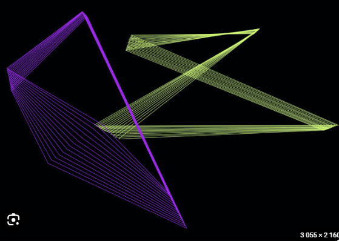

# Tömbök és listák

## Több objektum adatainak kezelése {#tombok}

Egy grafikus program gyakran több olyan objektumot kezel, amelyek azonos módon viselkednek, de különböző adatokkal rendelkeznek. Ha például ötven négyzet mozog a rajzfelületen, mindegyiknek külön tárolnunk kell a helyét, a sebességét és a méretét. A korábban megismert osztály alkalmas arra, hogy egy négyzet adatait együtt kezeljük. Több négyzetnél azonban magukat az objektumokat is célszerű közös adatszerkezetbe rendezni.

**Egyetlen mozgó négyzet.** A korábban megismert osztályokhoz hasonlóan a `Square` itt egy négyzetet ír le. Az `x` és `y` mezők a bal felső sarok helyét, a `side` az oldal hosszát, a `c` a színét tárolja. A `vx` és `vy` azt mondja meg, hány pixellel változzon a helye vízszintesen, illetve függőlegesen egy képkocka alatt. A konstruktor megkapja és elmenti ezeket a kezdeti értékeket. A `moveStep()` elmozdítja a négyzetet, és a rajzfelület szélén megfordítja a megfelelő sebességet; a `display()` a tárolt adatokból rajzolja ki a négyzetet. A `draw()` minden képkockában ezt a két műveletet hajtja végre egymás után.

:::processing-example title="1. változat – Egy mozgó négyzet" image="media/01-egy-negyzet.webp"
```processing
Square square;

void setup() {
  size(800, 480);
  square = new Square(120, 100, 3, 2, 60,
                      color(82, 175, 240));
}

void draw() {
  background(16, 22, 36);
  square.moveStep();
  square.display();
}

class Square {
  float x, y, vx, vy, side;
  color c;

  Square(float x, float y, float vx, float vy,
         float side, color c) {
    this.x = x;
    this.y = y;
    this.vx = vx;
    this.vy = vy;
    this.side = side;
    this.c = c;
  }

  void moveStep() {
    x += vx;
    y += vy;
    if (x < 0 || x > width - side) vx = -vx;
    if (y < 0 || y > height - side) vy = -vy;
  }

  void display() {
    noStroke();
    fill(c);
    rect(x, y, side, side);
  }
}
```

A `square = new Square(...)` egyetlen objektumot készít. A `square.moveStep()` hívásnál például az `x += vx` a négyzet vízszintes helyéhez adja hozzá a sebességét, a `vx = -vx` pedig a mozgás irányát fordítja meg. Az objektum értékei megmaradnak a `draw()` két lefutása között, ezért a következő képkocka ott folytatódik, ahol az előző véget ért.
:::

**Több négyzet tömbben.** Ha minden négyzethez külön `square1`, `square2`, `square3` változót hoznánk létre, nagyobb elemszámnál a program nehezen áttekinthetővé válna. A `Square[] squares = new Square[24];` utasítás egy **24 helyből álló tömböt** készít. Minden helyre egy `Square` objektumot tehetünk, de a tömb létrehozásakor még nem jön létre automatikusan a 24 négyzet. Ezért a `setup()` ciklusában mindegyik helyre készítünk egy új objektumot. Az indexelés nullától indul: az első elem `squares[0]`, az utolsó `squares[23]`. Egy tömbelemet a `squares[i]` kifejezéssel érünk el.

:::processing-example title="2. változat – Több négyzet egy tömbben" image="media/02-negyzet-tomb.webp"
```processing
Square[] squares = new Square[24];

void setup() {
  size(800, 480);

  for (int i = 0; i < squares.length; i++) {
    float side = random(20, 58);
    squares[i] = new Square(
      random(width - side),
      random(height - side),
      side,
      color(random(70, 230),
            random(90, 210),
            random(150, 255))
    );
  }
}

void draw() {
  background(16, 22, 36);
  for (int i = 0; i < squares.length; i++) {
    squares[i].display();
  }
}

class Square {
  float x, y, side;
  color c;

  Square(float x, float y, float side, color c) {
    this.x = x;
    this.y = y;
    this.side = side;
    this.c = c;
  }

  void display() {
    noStroke();
    fill(c);
    rect(x, y, side, side);
  }
}
```
:::

A tömb méretét a `squares.length` érték adja meg. A `length` itt nem metódus, ezért nincs utána kerek zárójel. A `setup()`-beli ciklus minden helyre más méretű, színű és pozíciójú négyzetet tesz. A `draw()`-beli ciklus ezután egyesével lekéri és megjeleníti őket. Mivel itt még nincs `moveStep()` hívás, az alakzatok egy helyben maradnak; a következő változatban éppen ezt egészítjük ki.

**A tömb elemei önállóan mozognak.** Most minden négyzetnek saját `vx` és `vy` sebessége is van, amelyet a konstruktor a négyzethez tartozó mezőkbe ment. A `setup()` egyszer hozza létre az összes objektumot, a `draw()` viszont képkockánként végigmegy rajtuk. A `Square s = squares[i]` az aktuális négyzetre hivatkozik. Az `s.moveStep()` módosítja a helyét, az `s.display()` pedig már az új helyen rajzolja ki. Így ugyanazzal a néhány utasítással tetszőleges számú — a tömb méretén belüli — négyzetet tudunk kezelni.

:::processing-example title="3. változat – A tömb elemei mozognak" image="media/03-mozgo-tomb.webp"
```processing
Square[] squares = new Square[60];

void setup() {
  size(800, 480);

  for (int i = 0; i < squares.length; i++) {
    float side = random(16, 44);
    squares[i] = new Square(
      random(width - side),
      random(height - side),
      random(-3, 3), random(-3, 3), side,
      color(random(75, 235),
            random(90, 215),
            random(130, 255))
    );
  }
}

void draw() {
  background(16, 22, 36);

  for (int i = 0; i < squares.length; i++) {
    Square s = squares[i];
    s.moveStep();
    s.display();
  }
}

class Square {
  float x, y, vx, vy, side;
  color c;

  Square(float x, float y, float vx, float vy,
         float side, color c) {
    this.x = x;
    this.y = y;
    this.vx = vx;
    this.vy = vy;
    this.side = side;
    this.c = c;
  }

  void moveStep() {
    x += vx;
    y += vy;
    if (x < 0 || x > width - side) vx = -vx;
    if (y < 0 || y > height - side) vy = -vy;
  }

  void display() {
    noStroke();
    fill(c);
    rect(x, y, side, side);
  }
}
```
:::

A tömb mérete a létrehozáskor rögzül. Az egyes elemeket kicserélhetjük, de a `new Square[60]` paranccsal létrehozott tömb nem válik automatikusan 61 eleművé. A Processingben vannak tömbmásolást és bővítést segítő metódusok, de változó elemszámnál célszerűbb lehet más adatszerkezetet választani.

## Dinamikus listák: ArrayList {#arraylist}

Az **`ArrayList`** olyan tároló, amelynek az elemszáma futás közben változhat. Tömb esetén előre megmondjuk, hány elemnek készítünk helyet (`new Square[60]`). Az `ArrayList` használatakor erre nincs szükség: kezdhetünk üres listával, és amikor a program új objektumot hoz létre, hozzáadhatjuk a meglévőkhöz.

A lista alapvető műveletei a következők. A példákban a `lista` egy már létrehozott lista, az `elem` pedig egy hozzáadni kívánt objektum.

- `new ArrayList<...>()` – üres lista létrehozása; a `...` az elemek típusának helyét jelöli.
- `lista.add(elem)` – az új objektumot a lista végére helyezi.
- `lista.get(i)` – lekéri az `i` indexű elemet. Az indexelés itt is nullától indul.
- `lista.size()` – megadja, hány elemet tárol a lista jelenleg.
- `lista.remove(i)` – eltávolítja az `i` indexű elemet; a mögötte lévők előrébb kerülnek.

A tényleges programban például a `Tile` a négyzetet leíró osztály neve, ezért ott `ArrayList<Tile>` szerepel. A listán végighaladó ciklus feltételében általában `i < lista.size()` áll, mert az elemszám futás közben változhat.
**Mi történik a háttérben?** Az `ArrayList` az elemeket belül egy tömbben tartja nyilván. Amikor létrejön vagy bővül, gyakran több helyet foglal le, mint amennyi elemet abban a pillanatban tárol. Így a következő néhány elemet újabb memóriafoglalás nélkül hozzá tudja adni. Ha ez a szabad hely is elfogy, a lista nagyobb tömböt készít, és a meglévő elemek hivatkozásait átmásolja oda. Ez a ritkán bekövetkező bővítés többlet memóriát és számítási munkát igényel; az egyszerű hozzáadás viszont többnyire gyors. Azért választunk listát, mert a felhasználó által létrehozott elemek száma előre nem ismert.

**Kattintással létrehozott négyzetek.** A program indulásakor a `tiles` lista üres. Azt, hogy a felhasználó hányat kattint majd, **nem tudjuk előre megmondani**. Minden `mousePressed()` eseménynél létrehozunk egy új `Tile` objektumot, és a `tiles.add(...)` hívással hozzáadjuk a listához. A `Tile` tárolja a négyzet helyét, oldalhosszát és színét; a konstruktora a kattintás közelébe helyezi, a `display()` pedig megrajzolja. A `draw()` minden képkockában annyi négyzetet jelenít meg, amennyi éppen a listában található.

:::processing-example title="1. változat – Négyzetek létrehozása kattintással" image="media/04-kattintas-lista.webp"
```processing
ArrayList<Tile> tiles = new ArrayList<Tile>();

void setup() {
  size(800, 480);
}

void draw() {
  background(16, 22, 36);

  for (int i = 0; i < tiles.size(); i++) {
    tiles.get(i).display();
  }
}

void mousePressed() {
  tiles.add(new Tile(mouseX, mouseY));
}

class Tile {
  float x, y, side;
  color c;

  Tile(float x, float y) {
    side = random(18, 65);
    this.x = x - side / 2;
    this.y = y - side / 2;
    c = color(random(85, 255),
              random(75, 205),
              random(105, 240));
  }

  void display() {
    noStroke();
    fill(c);
    rect(x, y, side, side);
  }
}
```
:::

**A létrehozott elemek mozognak.** A `Tile` osztályt most a `vx` és `vy` mezőkkel, valamint a `moveStep()` metódussal bővítjük. Az új négyzet a konstruktorában véletlen sebességet kap. A `draw()` az `i` indexű objektumot a `tiles.get(i)` hívással kéri le; utána először elmozdítja, majd kirajzolja. Az újonnan hozzáadott négyzetek a következő képkockáktól ugyanebben a ciklusban vesznek részt. A lista hosszát továbbra sem kell előre ismernünk.

:::processing-example title="2. változat – A kattintással létrehozott négyzetek mozognak" image="media/05-mozgo-lista.webp"
```processing
ArrayList<Tile> tiles = new ArrayList<Tile>();

void setup() {
  size(800, 480);
}

void draw() {
  background(16, 22, 36);

  for (int i = 0; i < tiles.size(); i++) {
    Tile t = tiles.get(i);
    t.moveStep();
    t.display();
  }
}

void mousePressed() {
  tiles.add(new Tile(mouseX, mouseY));
}

class Tile {
  float x, y, vx, vy, side;
  color c;

  Tile(float x, float y) {
    side = random(18, 60);
    this.x = x - side / 2;
    this.y = y - side / 2;
    vx = random(-3, 3);
    vy = random(-3, 3);
    c = color(random(85, 255),
              random(75, 205),
              random(105, 240));
  }

  void moveStep() {
    x += vx;
    y += vy;
    if (x < 0 || x > width - side) vx = -vx;
    if (y < 0 || y > height - side) vy = -vy;
  }

  void display() {
    noStroke();
    fill(c);
    rect(x, y, side, side);
  }
}
```
:::

**Elemek törlése.** Az `ArrayList` nemcsak bővíthető, hanem csökkenthető is. Bal kattintásnál `add(...)` adja hozzá az új négyzetet; jobb kattintásnál a `tiles.remove(tiles.size() - 1)` a lista utolsó elemét távolítja el. Ezt csak akkor hajtjuk végre, ha `tiles.size() > 0`, hiszen üres listában nincs eltávolítható elem. Így az alakzatok száma a felhasználó műveleteihez igazodik. A jobb kattintáshoz a Processing rajzablakának kell aktívnak lennie; egyes rendszereken ilyenkor helyi menü is megjelenhet.

:::processing-example title="3. változat – Hozzáadás és törlés" image="media/06-hozzaad-torol.webp"
```processing
ArrayList<Tile> tiles = new ArrayList<Tile>();

void setup() {
  size(800, 480);
}

void draw() {
  background(16, 22, 36);

  for (int i = 0; i < tiles.size(); i++) {
    Tile t = tiles.get(i);
    t.moveStep();
    t.display();
  }
}

void mousePressed() {
  if (mouseButton == LEFT) {
    tiles.add(new Tile(mouseX, mouseY));
  } else if (mouseButton == RIGHT && tiles.size() > 0) {
    tiles.remove(tiles.size() - 1);
  }
}

class Tile {
  float x, y, vx, vy, side;
  color c;

  Tile(float x, float y) {
    side = random(18, 60);
    this.x = x - side / 2;
    this.y = y - side / 2;
    vx = random(-3, 3);
    vy = random(-3, 3);
    c = color(random(85, 255),
              random(75, 205),
              random(105, 240));
  }

  void moveStep() {
    x += vx;
    y += vy;
    if (x < 0 || x > width - side) vx = -vx;
    if (y < 0 || y > height - side) vy = -vy;
  }

  void display() {
    noStroke();
    fill(c);
    rect(x, y, side, side);
  }
}
```
:::

## Ponthalmazok {#ponthalmazok}

A következő programban nem négyzeteket, hanem nagy számú pontot tárolunk listákban. A cél nem egyetlen alakzat mozgása, hanem annak megfigyelése, hogyan alakul ki a sok, egymástól függetlenül mozgó pontból egy összetett kép. Az ötlet a feltöltött `faa.pde` programból származik: két ponthalmaz véletlen bolyongását követjük, és a meglátogatott képpontok színét fokozatosan változtatjuk.

**1. változat – két ponthalmaz létrehozása.** A `Particle` osztály egy pont koordinátáit tárolja. A `seedGroup()` metódus egy listát tölt fel: 200 pontot helyez el egy nagyobb téglalap alakú területen, majd további 150-et egy belső, kisebb területen. A metódust kétszer hívjuk meg, így két külön, egyenként 350 elemű ponthalmazunk lesz. A két halmaz ugyanazon a rajzfelületen helyezkedik el, de eltérő színnel rajzoljuk ki őket. Egyelőre a pontok még nem mozognak. A bemutatás kedvéért a pontok itt hárompixelnyi méretűek; a színnyomokhoz később egypixeles pontokat használunk.

:::processing-example title="1. változat – Két ponthalmaz" image="media/07-ponthalmazok.webp"
```processing
ArrayList<Particle> cyanPoints = new ArrayList<Particle>();
ArrayList<Particle> warmPoints = new ArrayList<Particle>();

void setup() {
  size(800, 600);
  background(0);
  seedGroup(cyanPoints);
  seedGroup(warmPoints);
}

void draw() {
  background(0);
  strokeWeight(3);

  stroke(0, 180, 180);
  for (int i = 0; i < cyanPoints.size(); i++) {
    Particle p = cyanPoints.get(i);
    point(p.x, p.y);
  }

  stroke(230, 160, 80);
  for (int i = 0; i < warmPoints.size(); i++) {
    Particle p = warmPoints.get(i);
    point(p.x, p.y);
  }
}

void seedGroup(ArrayList<Particle> group) {
  for (int i = 0; i < 200; i++) {
    group.add(new Particle(
      random(50, width - 50),
      random(50, height - 50)
    ));
  }
  for (int i = 0; i < 150; i++) {
    group.add(new Particle(
      random(150, width - 150),
      random(150, height - 150)
    ));
  }
}

class Particle {
  float x, y;

  Particle(float x, float y) {
    this.x = x;
    this.y = y;
  }
}
```
:::

**2. változat – véletlen bolyongás.** A `Particle` osztály egy `moveStep()` metódussal egészül ki. Ez minden képkockában vízszintesen és függőlegesen is véletlen, −2 és 2 pixel közötti elmozdulást ad a pont helyéhez. A `constrain()` megakadályozza, hogy a koordináták kikerüljenek az ablakból: a szélen a pont a határ közelében marad, majd a későbbi véletlen lépések során visszatérhet a belső területre. A `background(0)` továbbra is a `draw()`-ban szerepel, ezért csak a pontok pillanatnyi helyzete látható.

:::processing-example title="2. változat – Véletlenül mozgó pontok" image="media/08-bolyongo-pontok.webp"
```processing
ArrayList<Particle> cyanPoints = new ArrayList<Particle>();
ArrayList<Particle> warmPoints = new ArrayList<Particle>();

void setup() {
  size(800, 600);
  background(0);
  seedGroup(cyanPoints);
  seedGroup(warmPoints);
}

void draw() {
  background(0);
  strokeWeight(3);

  stroke(0, 180, 180);
  for (int i = 0; i < cyanPoints.size(); i++) {
    Particle p = cyanPoints.get(i);
    p.moveStep();
    point(p.x, p.y);
  }

  stroke(230, 160, 80);
  for (int i = 0; i < warmPoints.size(); i++) {
    Particle p = warmPoints.get(i);
    p.moveStep();
    point(p.x, p.y);
  }
}

void seedGroup(ArrayList<Particle> group) {
  for (int i = 0; i < 200; i++) {
    group.add(new Particle(
      random(50, width - 50),
      random(50, height - 50)
    ));
  }
  for (int i = 0; i < 150; i++) {
    group.add(new Particle(
      random(150, width - 150),
      random(150, height - 150)
    ));
  }
}

class Particle {
  float x, y;

  Particle(float x, float y) {
    this.x = x;
    this.y = y;
  }

  void moveStep() {
    x = constrain(x + random(-2, 2), 0, width - 1);
    y = constrain(y + random(-2, 2), 0, height - 1);
  }
}
```
:::

**3. változat – a meglátogatott képpontok színezése.** Most nem töröljük le a rajzot minden képkocka előtt. Sőt, egy `color[][] ink` kétdimenziós tömbben azt is megjegyezzük, hogy az egyes képpontok milyen színt értek már el. A tömb első indexe a vízszintes, a második a függőleges képpontkoordináta. A `colorPixel()` kiolvassa az adott képpont korábbi színét, majd a kékeszöld ponthalmaz látogatásakor a zöld és kék összetevőt, a másik halmaznál a piros és zöld összetevőt növeli 50-nel. Végül pontosan egy képpontot rajzol ki az új színnel. A színek erősödnek, ha ugyanazt a képpontot többször elérik a pontok, de nem egy nagyobb, áttetsző folt jelenik meg minden lépésnél.

:::processing-example title="3. változat – A mozgás színnyomot hagy" image="media/09-pontnyomok.webp"
```processing
ArrayList<Particle> cyanPoints = new ArrayList<Particle>();
ArrayList<Particle> warmPoints = new ArrayList<Particle>();

color[][] ink;

void setup() {
  size(800, 600);
  background(0);
  ink = new color[width][height];
  seedGroup(cyanPoints);
  seedGroup(warmPoints);
}

void draw() {
  strokeWeight(1);

  for (int i = 0; i < cyanPoints.size(); i++) {
    Particle p = cyanPoints.get(i);
    p.moveStep();
    colorPixel(p, true);
  }
  for (int i = 0; i < warmPoints.size(); i++) {
    Particle p = warmPoints.get(i);
    p.moveStep();
    colorPixel(p, false);
  }
}

void seedGroup(ArrayList<Particle> group) {
  for (int i = 0; i < 200; i++) {
    group.add(new Particle(
      random(50, width - 50),
      random(50, height - 50)
    ));
  }
  for (int i = 0; i < 150; i++) {
    group.add(new Particle(
      random(150, width - 150),
      random(150, height - 150)
    ));
  }
}

void colorPixel(Particle p, boolean cyan) {
  int px = int(p.x);
  int py = int(p.y);
  color oldColor = ink[px][py];

  if (cyan) {
    ink[px][py] = color(
      red(oldColor),
      green(oldColor) + 50,
      blue(oldColor) + 50
    );
  } else {
    ink[px][py] = color(
      red(oldColor) + 50,
      green(oldColor) + 50,
      blue(oldColor)
    );
  }

  stroke(ink[px][py]);
  point(px, py);
}

class Particle {
  float x, y;

  Particle(float x, float y) {
    this.x = x;
    this.y = y;
  }

  void moveStep() {
    x = constrain(x + random(-2, 2), 0, width - 1);
    y = constrain(y + random(-2, 2), 0, height - 1);
  }
}
```
:::

A `color[][]` kétdimenziós tömb a képpontok színeit tárolja, míg a két `ArrayList<Particle>` a mozgó pontok aktuális helyzetét. A feladatnál tehát kétféle adatot tartunk nyilván: **mi mozog**, illetve **milyen nyom maradt utána**. A `background()` csak a `setup()`-ban szerepel, mert a képkockák között meg akarjuk őrizni a kialakuló képet.

**4. változat – a kiinduló pontok két metsző körön helyezkednek el.** A pontok létrehozását módosítjuk, a mozgást és a színezést nem. A `seedArc()` metódus két kör kerületén helyez el 350–350 pontot. A `TWO_PI` a teljes kör szögét, a `cos()` és a `sin()` pedig a középponthoz viszonyított koordinátákat adja meg. Az első képkockákban ezért még felismerhető a két kör. Később azonban a pontok **nem maradnak a körök közelében**: a `moveStep()` ugyanazt a véletlen bolyongást végzi, mint korábban, nincs benne visszahúzás az eredeti pozícióhoz. Hosszabb futás során a színes nyomok fokozatosan távolodnak a körvonalaktól, és a rajzfelület egyre nagyobb részét érhetik el.

:::processing-example title="4. változat – Két körből kiinduló ponthalmazok" image="media/10-korivek.webp"
```processing
ArrayList<Particle> cyanPoints = new ArrayList<Particle>();
ArrayList<Particle> warmPoints = new ArrayList<Particle>();

color[][] ink;

void setup() {
  size(800, 600);
  background(0);
  ink = new color[width][height];

  seedArc(cyanPoints, 310, 300, 145);
  seedArc(warmPoints, 490, 300, 145);
}

void draw() {
  strokeWeight(1);

  for (int i = 0; i < cyanPoints.size(); i++) {
    Particle p = cyanPoints.get(i);
    p.moveStep();
    colorPixel(p, true);
  }
  for (int i = 0; i < warmPoints.size(); i++) {
    Particle p = warmPoints.get(i);
    p.moveStep();
    colorPixel(p, false);
  }
}

void seedArc(ArrayList<Particle> group,
             float centerX, float centerY,
             float radius) {
  for (int i = 0; i < 350; i++) {
    float angle = random(TWO_PI);
    group.add(new Particle(
      centerX + cos(angle) * radius,
      centerY + sin(angle) * radius
    ));
  }
}

void colorPixel(Particle p, boolean cyan) {
  int px = int(p.x);
  int py = int(p.y);
  color oldColor = ink[px][py];

  if (cyan) {
    ink[px][py] = color(
      red(oldColor),
      green(oldColor) + 50,
      blue(oldColor) + 50
    );
  } else {
    ink[px][py] = color(
      red(oldColor) + 50,
      green(oldColor) + 50,
      blue(oldColor)
    );
  }

  stroke(ink[px][py]);
  point(px, py);
}

class Particle {
  float x, y;

  Particle(float x, float y) {
    this.x = x;
    this.y = y;
  }

  void moveStep() {
    x = constrain(x + random(-2, 2), 0, width - 1);
    y = constrain(y + random(-2, 2), 0, height - 1);
  }
}
```
:::

Ez a változat az eredeti `faa.pde` mozgás- és színfelhalmozási elvét követi, de két körvonalról indul. A körök csak kezdeti ponteloszlást adnak: a későbbi rajzot már a véletlen mozgás és a képpontok ismételt színezése alakítja.

## Mozgó vonalalakzatok – képernyővédő példa {#kepernyovedo}

Az alábbi referencián egymáshoz közel elhelyezkedő, színes vonalalakzatok korábbi állapotai jelennek meg egyidejűleg. Az egymásra rajzolt állapotok mozgó, sűrű vonalkötegek hatását keltik.



A megvalósításban nem elég csak az aktuális pozíciót tárolnunk: a korábbi képkockák alakzatainak adatait is meg kell őrizni. Az egyszerűség kedvéért egy három csúcsból álló vonalalakzatból indulunk ki, de ugyanez a szerkezet több csúcsra is kiterjeszthető.

**1. változat – egy vonalalakzat.** Három csúcsból álló zárt alakzatot rajzolunk. A három `x` és három `y` koordinátát két tömbben tároljuk: azonos indexű elemeik ugyanannak a csúcsnak a helyét adják meg. A `beginShape()` elkezdi az alakzatot, a ciklus `vertex(x[i], y[i])` hívásai sorban felveszik a csúcsokat, az `endShape(CLOSE)` pedig az utolsó pontot visszaköti az elsőhöz.

:::processing-example title="1. változat – Három pontból álló vonalalakzat" image="media/11-haromszog.webp"
```processing
float[] x = {130, 400, 260};
float[] y = {120, 140, 350};

void setup() {
  size(800, 480);
}

void draw() {
  background(5, 8, 14);
  noFill();
  stroke(176, 76, 235);
  strokeWeight(2);

  beginShape();
  for (int i = 0; i < x.length; i++) {
    vertex(x[i], y[i]);
  }
  endShape(CLOSE);
}
```
:::

**2. változat – a csúcsok mozgása.** Az `x` és `y` koordináták mellé két további tömb kerül: a `vx` és `vy` az azonos indexű csúcs vízszintes és függőleges sebességét tárolja. Minden `draw()`-lefutáskor a ciklus hozzáadja a sebességet a koordinátákhoz. Ha egy csúcs eléri a rajzfelület szélét, a megfelelő sebesség előjelét megfordítjuk, így a csúcs a következő képkockában visszafelé indul. A vonalalakzat folyamatosan változik, mert a csúcsai nem egyformán mozognak.

:::processing-example title="2. változat – A három csúcs mozgása" image="media/12-mozgo-csucsok.webp"
```processing
float[] x  = {130, 400, 260};
float[] y  = {120, 140, 350};
float[] vx = {2.1, -1.5, 1.3};
float[] vy = {1.4, 2.0, -1.8};

void setup() {
  size(800, 480);
}

void draw() {
  background(5, 8, 14);

  for (int i = 0; i < x.length; i++) {
    x[i] += vx[i];
    y[i] += vy[i];

    if (x[i] < 20 || x[i] > width - 20) vx[i] *= -1;
    if (y[i] < 20 || y[i] > height - 20) vy[i] *= -1;
  }

  noFill();
  stroke(176, 76, 235);
  strokeWeight(2);

  beginShape();
  for (int i = 0; i < x.length; i++) {
    vertex(x[i], y[i]);
  }
  endShape(CLOSE);
}
```
:::

**3. változat – az előző állapotok tárolása.** Most egyszerre több, korábbi helyzetű alakzatot szeretnénk látni. A `TriangleFrame` osztály egyetlen képkocka három csúcsának koordinátáit tárolja. A `history` lista ezeknek a korábbi állapotoknak a sorozatát őrzi. A `history.add(new TriangleFrame(x, y))` minden képkockán új másolatot készít; amikor a lista 28 elemnél nagyobb lesz, a `remove(0)` eltávolítja a legrégebbit. Azért készítünk másolatot, mert különben a korábbi alakzatok koordinátái is együtt változnának az aktuálisakkal. A `display()` minden elmentett állapotot külön megrajzol, ezért jelenik meg a vonalköteg.

:::processing-example title="3. változat – Korábbi állapotok megőrzése" image="media/13-vonalkovetes.webp"
```processing
float[] x  = {130, 400, 260};
float[] y  = {120, 140, 350};
float[] vx = {2.1, -1.5, 1.3};
float[] vy = {1.4, 2.0, -1.8};

ArrayList<TriangleFrame> history = new ArrayList<TriangleFrame>();

void setup() {
  size(800, 480);
}

void draw() {
  background(5, 8, 14);

  for (int i = 0; i < x.length; i++) {
    x[i] += vx[i];
    y[i] += vy[i];
    if (x[i] < 20 || x[i] > width - 20) vx[i] *= -1;
    if (y[i] < 20 || y[i] > height - 20) vy[i] *= -1;
  }

  history.add(new TriangleFrame(x, y));

  if (history.size() > 28) {
    history.remove(0);
  }

  noFill();
  for (int i = 0; i < history.size(); i++) {
    stroke(176, 76, 235, 25 + i * 7);
    history.get(i).display();
  }
}

class TriangleFrame {
  float[] x = new float[3];
  float[] y = new float[3];

  TriangleFrame(float[] px, float[] py) {
    for (int i = 0; i < 3; i++) {
      x[i] = px[i];
      y[i] = py[i];
    }
  }

  void display() {
    beginShape();
    for (int i = 0; i < 3; i++) {
      vertex(x[i], y[i]);
    }
    endShape(CLOSE);
  }
}
```
:::

**4. változat – négy- és ötcsúcsú mozgó alakzat.** A `MovingShape` osztály már tetszőleges, legalább három csúcsú poligont tud kezelni. A konstruktor első paramétere, a `vertexCount`, azt adja meg, **hány csúcsa legyen az alakzatnak**. Ezzel az értékkel hozzuk létre az `x`, `y`, `vx` és `vy` tömböket, így a programnak nem kell külön osztály egy négyszöghöz és egy ötszöghöz.

A konstruktor a csúcsokat először egy kör mentén helyezi el. Az `angle` az adott csúcs szöge, amelyet a `TWO_PI * i / vertexCount` képlettel számítunk ki; az `i` minden csúcsnál eggyel nő, ezért a pontok egyenletesen követik egymást a körön. A `cos()` és a `sin()` ebből a szögből számítja ki a koordinátákat. Ezután minden csúcs saját vízszintes és függőleges sebességet kap, így a kezdetben szabályos alakzat a mozgás során fokozatosan torzul.

A `moveStep()` képkockánként módosítja a csúcsok helyét, és eltárol egy pillanatképet a `history` listában. A `PolygonFrame` konstruktora **új tömbökbe másolja** az aktuális koordinátákat: ez azért szükséges, hogy a régebbi alakzatok ne mozogjanak együtt a mostanival. A `display()` ezeket az állapotokat rajzolja egymásra, a korábbi vonalak halványabbak.

Két példányt hozunk létre: a lila alakzatot **4 csúccsal**, a zöldet **5 csúccsal**. Ugyanaz az osztály és ugyanazok a metódusok működtetik mindkettőt.

:::processing-example title="4. változat – Négy- és ötcsúcsú mozgó poligon" image="media/14-kepernyovedo.webp"
```processing
MovingShape violet;
MovingShape green;

void setup() {
  size(800, 480);

  violet = new MovingShape(
    4, color(172, 70, 240), 205, 250
  );
  green = new MovingShape(
    5, color(194, 235, 94), 565, 250
  );
}

void draw() {
  background(5, 8, 14);

  violet.moveStep();
  green.moveStep();

  violet.display();
  green.display();
}

class MovingShape {
  float[] x, y, vx, vy;
  color c;

  ArrayList<PolygonFrame> history =
    new ArrayList<PolygonFrame>();

  MovingShape(int vertexCount, color c,
              float centerX, float centerY) {
    this.c = c;

    x = new float[vertexCount];
    y = new float[vertexCount];
    vx = new float[vertexCount];
    vy = new float[vertexCount];

    for (int i = 0; i < vertexCount; i++) {
      float angle = TWO_PI * i / vertexCount;
      float radius = 95;

      x[i] = centerX + cos(angle) * radius;
      y[i] = centerY + sin(angle) * radius;

      vx[i] = random(-2.2, 2.2);
      vy[i] = random(-2.2, 2.2);
    }
  }

  void moveStep() {
    for (int i = 0; i < x.length; i++) {
      x[i] += vx[i];
      y[i] += vy[i];

      if (x[i] < 15 || x[i] > width - 15)
        vx[i] *= -1;
      if (y[i] < 15 || y[i] > height - 15)
        vy[i] *= -1;
    }

    history.add(new PolygonFrame(x, y));
    if (history.size() > 28) {
      history.remove(0);
    }
  }

  void display() {
    noFill();
    strokeWeight(1.3);

    for (int i = 0; i < history.size(); i++) {
      stroke(c, 24 + i * 8);
      history.get(i).display();
    }
  }
}

class PolygonFrame {
  float[] x;
  float[] y;

  PolygonFrame(float[] px, float[] py) {
    x = new float[px.length];
    y = new float[py.length];

    for (int i = 0; i < px.length; i++) {
      x[i] = px[i];
      y[i] = py[i];
    }
  }

  void display() {
    beginShape();
    for (int i = 0; i < x.length; i++) {
      vertex(x[i], y[i]);
    }
    endShape(CLOSE);
  }
}
```
:::

A két záró példa ugyanazt a gondolatot alkalmazza eltérő módon. A ponthalmazoknál a lista az egymástól függetlenül mozgó pontokat tárolja; a képernyővédőnél a lista **ugyanannak az alakzatnak a korábbi állapotait** őrzi meg. Az utóbbi eset mutatja meg különösen jól, hogy a grafikus programokban nemcsak a jelenlegi, hanem a korábbi adatok tárolása is szükséges lehet.
