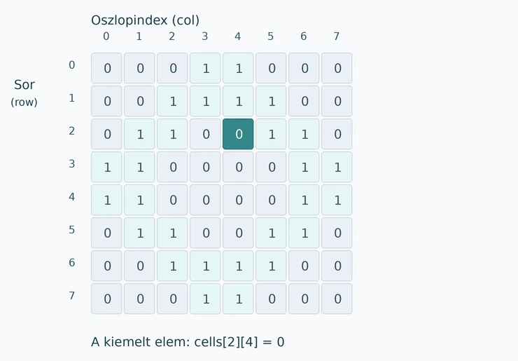

# Kétdimenziós tömbök

Az előző fejezetben egy tömb több objektum adatait tárolta. Vannak azonban olyan feladatok, amelyekben az elemek nem egyszerűen egymás után következnek, hanem **sorokból és oszlopokból álló rácsban** helyezkednek el. Ilyen lehet egy játék pályája, egy négyzetrácsra épülő rajz vagy egy egyszerű képpontminta. Ezeket kétdimenziós tömbben természetes leírni, mert egy elem helyét két adattal, a sor és az oszlop indexével tudjuk megadni.

## Sorok és oszlopok {#sorok-oszlopok}

A kétdimenziós tömböt a legegyszerűbb számtáblázatként elképzelni. Az alábbi példában a táblázat nyolc sorból áll, és minden sorban nyolc szám található. A `0` és az `1` jelentését mi határozzuk meg: most a `0` sötét, az `1` világos mezőt jelöl.

**1. változat – kézzel megadott minta.** A mátrixban elhelyezett számok önmagukban még nem rajzolnak semmit. Két egymásba ágyazott `for` ciklussal végigjárjuk az elemeket, és minden szám helyére egy négyzetet rajzolunk.

:::processing-example title="Számokból kirajzolt négyzetes minta" image="media/01-szammatrix.webp"
```processing
int[][] cells = {
  {0, 0, 0, 1, 1, 0, 0, 0},
  {0, 0, 1, 1, 1, 1, 0, 0},
  {0, 1, 1, 0, 0, 1, 1, 0},
  {1, 1, 0, 0, 0, 0, 1, 1},
  {1, 1, 0, 0, 0, 0, 1, 1},
  {0, 1, 1, 0, 0, 1, 1, 0},
  {0, 0, 1, 1, 1, 1, 0, 0},
  {0, 0, 0, 1, 1, 0, 0, 0}
};

void setup() {
  size(400, 400);
  noStroke();

  int cellSize = 50;

  for (int row = 0; row < cells.length; row++) {
    for (int col = 0; col < cells[row].length; col++) {
      if (cells[row][col] == 1) {
        fill(105, 220, 205);
      } else {
        fill(21, 35, 54);
      }

      rect(col * cellSize, row * cellSize,
           cellSize, cellSize);
    }
  }
}
```
:::

Az `int[][]` azt jelenti, hogy egész számokat tartalmazó kétdimenziós tömböt hozunk létre. A `cells[row][col]` kifejezésben **először a sor**, utána az oszlop indexét adjuk meg. Mindkettőt nullától számozzuk, ezért például a `cells[2][4]` a harmadik sor ötödik eleme. A `cells.length` a sorok számát, a `cells[row].length` pedig az adott sorban található elemek számát adja meg. Az oszlopindex a négyzet vízszintes, a sorindex a függőleges koordinátáját határozza meg.



A tömb adatait és a rajzolás módját érdemes megkülönböztetni. A mátrix csak számokat tárol; a `fill()` és a `rect()` dönti el, hogy a számokhoz milyen színek és alakzatok tartoznak. A megjelenést később a számok megváltoztatása nélkül is módosíthatjuk.

**2. változat – a tömb elemeit a program állítja elő.** Nem szükséges minden értéket kézzel beírni. A `new int[12][12]` egy 12 sorból és 12 oszlopból álló mátrix számára foglal helyet. Az új egészszám-tömb elemei kezdetben `0` értékűek. A következő program a két átlóhoz tartozó cellákba `1`-est tesz, majd kirajzolja a mintát.

:::processing-example title="Kétdimenziós tömb feltöltése ciklussal" image="media/03-ket-atlo.webp"
```processing
int rows = 12;
int cols = 12;
int[][] cells = new int[rows][cols];

void setup() {
  size(480, 480);
  noStroke();

  for (int row = 0; row < rows; row++) {
    for (int col = 0; col < cols; col++) {
      if (row == col || row + col == cols - 1) {
        cells[row][col] = 1;
      }
    }
  }

  int cellSize = 40;

  for (int row = 0; row < rows; row++) {
    for (int col = 0; col < cols; col++) {
      if (cells[row][col] == 1) {
        fill(235, 145, 100);
      } else {
        fill(20, 33, 53);
      }

      rect(col * cellSize, row * cellSize,
           cellSize, cellSize);
    }
  }
}
```
:::

A külső ciklus egy adott sort választ, a belső ciklus pedig végigmegy annak minden oszlopán. A `row == col` a bal felső és jobb alsó sarok közötti átlót, a `row + col == cols - 1` a másik átlót jelöli. Ha egyik feltétel sem teljesül, az elem `0` marad. A kétdimenziós tömb méretét létrehozáskor meg kell adnunk, és az később nem növekszik magától, éppúgy, mint a korábban tanult egydimenziós tömbök esetében.

## A mátrix módosítása {#modositas}

Az eddigi programok egyszer készítették el a rajzot. A kétdimenziós tömb különösen hasznos akkor, amikor **a cellák állapotát meg akarjuk őrizni, majd később módosítani**. A következő programban kezdetben minden mező sötét. Ha valamelyik mezőre kattintunk, az értéke `0`-ról `1`-re, újabb kattintásra pedig vissza `0`-ra változik.

:::processing-example title="Kattintással szerkeszthető pixelrács – néhány kattintás után" image="media/04-pixelrajzolo.webp"
```processing
int rows = 12;
int cols = 16;
int cellSize = 40;

int[][] cells = new int[rows][cols];

void setup() {
  size(640, 480);
}

void draw() {
  background(20, 33, 53);
  stroke(45, 65, 81);

  for (int row = 0; row < rows; row++) {
    for (int col = 0; col < cols; col++) {
      if (cells[row][col] == 1) {
        fill(105, 220, 205);
      } else {
        fill(20, 33, 53);
      }

      rect(col * cellSize, row * cellSize,
           cellSize, cellSize);
    }
  }
}

void mousePressed() {
  if (mouseX >= 0 && mouseX < width &&
      mouseY >= 0 && mouseY < height) {

    int col = mouseX / cellSize;
    int row = mouseY / cellSize;

    cells[row][col] = 1 - cells[row][col];
  }
}
```
:::

A `mousePressed()` az egérkattintáskor fut le. A `mouseX / cellSize` és `mouseY / cellSize` egész számként megadja, melyik cellában van az egér; például az `x = 95` koordináta 40 pixeles celláknál a második, `1` indexű oszlophoz tartozik. A határellenőrzés megakadályozza, hogy a program a tömbön kívüli cellát próbáljon módosítani. A `cells[row][col] = 1 - cells[row][col]` kifejezés egyszerű állapotváltás: a `0`-ból `1`, az `1`-ből `0` lesz.

A `draw()` minden képkockában ismét kirajzolja az egész rácsot az **aktuálisan tárolt értékekből**. A kattintás nem közvetlenül a négyzetet színezi át, hanem a tömb egyik elemét változtatja meg. Emiatt a módosítás a következő képkockákban is megmarad. A rács és az adatok összekapcsolásának ezt a módját más interaktív alkotásoknál is használhatjuk.

## Átlós mintázat: 10 PRINT {#10print}

A generatív grafika egyik ismert történeti példája a Commodore 64 számítógéphez kötődő **10 PRINT** program. A program véletlenszerűen kétféle átlós jelet ír egymás mellé, így labirintusszerű mintázat jön létre. Az eredeti, rövid BASIC-programnak nincs szüksége kétdimenziós tömbre, mert a jeleket egymás után rajzolja ki. **Mi szándékosan eltároljuk a cellák állapotát**, hogy a kész képet később szerkeszteni tudjuk.

Művészeti és programtörténeti háttér: [10 PRINT – MIT Press](https://mitpress.mit.edu/9780262018463/10-print-chr205-5rnd1-goto-10/) és [MIT News – Life in BASIC](https://news.mit.edu/2013/10-print-chr2055rnd1-goto-10).

**1. változat – kétféle átló szabályos elrendezésben.** A mátrixban a `0` az egyik, az `1` a másik irányú átlót jelenti. A `drawTile()` metódus megkapja egy cella sor- és oszlopindexét, kiszámítja a helyét, majd az eltárolt értéknek megfelelő vonalat rajzolja meg.

:::processing-example title="Kétféle átló szabályos elrendezésben" image="media/05-atlok-szabalyos.webp"
```processing
int rows = 12;
int cols = 18;
int cellSize = 40;
int[][] tiles = new int[rows][cols];

void setup() {
  size(720, 480);
  background(15, 23, 37);
  stroke(230, 232, 216);
  strokeWeight(4);

  for (int row = 0; row < rows; row++) {
    for (int col = 0; col < cols; col++) {
      tiles[row][col] = (row + col) % 2;
      drawTile(row, col);
    }
  }
}

void drawTile(int row, int col) {
  int x = col * cellSize;
  int y = row * cellSize;

  if (tiles[row][col] == 0) {
    line(x, y, x + cellSize, y + cellSize);
  } else {
    line(x + cellSize, y, x, y + cellSize);
  }
}
```
:::

A `(row + col) % 2` az osztási maradék alapján felváltva `0` és `1` értéket ad. Ezért a minta szabályos: a kétféle vonal egymást váltja. A `drawTile()` metódus itt nem újabb adatot hoz létre, hanem **a tömbben lévő adatot jeleníti meg**.

**2. változat – véletlenszerű átlók.** A cellák értékét most `random(2)` segítségével választjuk ki. A `(int)` típusátalakítás elhagyja a véletlen szám törtrészét, így `0` vagy `1` kerül a tömbbe. A rajzolási szabály változatlan, csak a cellák értékét másképp állítjuk elő.

:::processing-example title="Véletlenszerű átlóminta – 10 PRINT jellegű kompozíció" image="media/06-atlok-veletlen.webp"
```processing
int rows = 12;
int cols = 18;
int cellSize = 40;
int[][] tiles = new int[rows][cols];

void setup() {
  size(720, 480);
  background(15, 23, 37);
  stroke(230, 232, 216);
  strokeWeight(4);

  for (int row = 0; row < rows; row++) {
    for (int col = 0; col < cols; col++) {
      tiles[row][col] = (int) random(2);
      drawTile(row, col);
    }
  }
}

void drawTile(int row, int col) {
  int x = col * cellSize;
  int y = row * cellSize;

  if (tiles[row][col] == 0) {
    line(x, y, x + cellSize, y + cellSize);
  } else {
    line(x + cellSize, y, x, y + cellSize);
  }
}
```
:::

A program újrafuttatásakor új mintát kapunk. A kétdimenziós tömb viszont azt is lehetővé teszi, hogy a már létrejött mintát változtatás nélkül újrarajzoljuk, vagy csak egy kiválasztott cella értékét módosítsuk.

## Íves csempék: Truchet-mintázat {#truchet}

A Truchet-csempék alapgondolata, hogy néhány egyszerű négyzetlap különféle elforgatásokban nagyon sok összetett mintázatot hozhat létre. A négyzetekbe rajzolt, két negyedkörívből álló változat szomszédos cellákon átívelő, összefüggő vonalrendszereket eredményez. A csempék íves változatáról és történetéről: [Infinitely Variable Tiling Patterns: From Truchet to Sol LeWitt Revisited](https://www.sciencedirect.com/science/article/pii/S2666389920301124).

**3. változat – az átlók helyett körívek.** Az eddigi mátrixot megtartjuk: minden cella továbbra is `0` vagy `1`. Csak a `drawTile()` metódust cseréljük ki. Az egyenes átlók helyett a négyzet két szemközti sarkából indított negyedköríveket rajzolunk, így a szomszédos lapok ívei egymáshoz kapcsolódhatnak.

:::processing-example title="Truchet-csempék véletlen elrendezésben" image="media/07-truchet.webp"
```processing
int rows = 12;
int cols = 18;
int cellSize = 40;
int[][] tiles = new int[rows][cols];

void setup() {
  size(720, 480);

  for (int row = 0; row < rows; row++) {
    for (int col = 0; col < cols; col++) {
      tiles[row][col] = (int) random(2);
    }
  }

  background(12, 19, 32);
  noFill();
  strokeWeight(7);

  for (int row = 0; row < rows; row++) {
    for (int col = 0; col < cols; col++) {
      drawTile(row, col);
    }
  }
}

void drawTile(int row, int col) {
  int x = col * cellSize;
  int y = row * cellSize;

  if (tiles[row][col] == 0) {
    stroke(104, 220, 208);
    arc(x, y, cellSize, cellSize,
        0, HALF_PI);
    arc(x + cellSize, y + cellSize,
        cellSize, cellSize,
        PI, PI + HALF_PI);
  } else {
    stroke(239, 167, 113);
    arc(x + cellSize, y,
        cellSize, cellSize,
        HALF_PI, PI);
    arc(x, y + cellSize,
        cellSize, cellSize,
        PI + HALF_PI, TWO_PI);
  }
}
```
:::

Az új `arc()` utasítás egy körív kirajzolására szolgál. Első négy paramétere az ellipszis középpontját és méretét adja meg, az utolsó kettő a kezdő és végső szöget. A Processing a szögeket radiánban várja; a `HALF_PI` negyedfordulatnak, a `PI` félfordulatnak, a `TWO_PI` teljes fordulatnak felel meg. Itt nincs szükség a szögek kiszámítására, mert a négyzet sarkaiban mindig ugyanazokat a negyedköríveket használjuk. A `noFill()` miatt csak a körívek vonala látszik.

**4. változat – interaktív kompozíció.** A mintát most `draw()` rajzolja újra. Kattintáskor megkeressük a kiválasztott cellát, majd a `0` és `1` értékét felcseréljük. A körívpár így a másik elrendezésbe kerül, miközben a többi cella változatlan marad.

:::processing-example title="Interaktív Truchet-mintázat – kattintással módosítható cellák" image="media/08-truchet-interaktiv.webp"
```processing
int rows = 12;
int cols = 18;
int cellSize = 40;
int[][] tiles = new int[rows][cols];

void setup() {
  size(720, 480);

  for (int row = 0; row < rows; row++) {
    for (int col = 0; col < cols; col++) {
      tiles[row][col] = (int) random(2);
    }
  }
}

void draw() {
  background(12, 19, 32);
  noFill();
  strokeWeight(7);

  for (int row = 0; row < rows; row++) {
    for (int col = 0; col < cols; col++) {
      drawTile(row, col);
    }
  }
}

void mousePressed() {
  if (mouseX >= 0 && mouseX < width &&
      mouseY >= 0 && mouseY < height) {

    int col = mouseX / cellSize;
    int row = mouseY / cellSize;

    tiles[row][col] = 1 - tiles[row][col];
  }
}

void drawTile(int row, int col) {
  int x = col * cellSize;
  int y = row * cellSize;

  if (tiles[row][col] == 0) {
    stroke(104, 220, 208);
    arc(x, y, cellSize, cellSize,
        0, HALF_PI);
    arc(x + cellSize, y + cellSize,
        cellSize, cellSize,
        PI, PI + HALF_PI);
  } else {
    stroke(239, 167, 113);
    arc(x + cellSize, y,
        cellSize, cellSize,
        HALF_PI, PI);
    arc(x, y + cellSize,
        cellSize, cellSize,
        PI + HALF_PI, TWO_PI);
  }
}
```
:::

A végeredményben a kétdimenziós tömb **nem egy kép másolatát**, hanem a kép létrehozásához szükséges döntéseket tárolja. A `tiles[row][col]` értéke azt mondja meg, melyik csempe kerüljön az adott helyre. Ugyanebből az adathalmazból más rajzolási szabállyal egészen eltérő kompozíció is készíthető. Ez a rácsalapú képek és animációk kezelésének egyik alapelve.

**Önálló kipróbálás.** Érdemes megváltoztatni a cellaméretet és vele együtt a sorok, oszlopok számát; kipróbálni, hogyan változik a kép, ha a csempék `0` és `1` állapotához más színt rendelünk; illetve megfigyelni, miként módosítják az összefüggő vonalakat a szomszédos cellákra adott kattintások. Egy későbbi bővítésnél a szomszédos cellák állapotait is megvizsgálhatjuk, és azok alapján dönthetünk egy cella megjelenítéséről.
