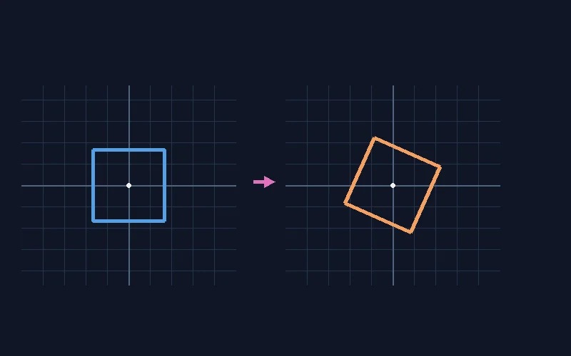

# Geometriai transzformációk

Eddig egy alakzat helyét a rajzoló utasításnak átadott koordinátákkal változtattuk. A Processing azonban azt is lehetővé teszi, hogy **a rajzoláshoz használt koordinátarendszert változtassuk meg**. Ezt úgy képzelhetjük el, mintha a toll alatt a rajzlap koordinátahálóját tolnánk el, forgatnánk vagy nagyítanánk. A már kirajzolt alakzatok ettől nem mozdulnak el; a változás az ezután végrehajtott rajzolási utasításokra hat.

## A transzformációk alapjai {#alapok}

A három legfontosabb művelet a `translate(x, y)` (eltolás), a `rotate(angle)` (forgatás) és a `scale(s)` (méretezés). A szöget radiánban adjuk meg: `PI / 2` negyed, `PI` fél, `TWO_PI` pedig teljes fordulatot jelent. Nem kell transzformációs mátrixokat számolnunk; elég, ha értjük, hogyan változnak a következő rajzolási utasítások koordinátái.



**Eltolás.** Az első négyzetet még a szokásos koordinátákkal rajzoljuk, majd az origót egy másik helyre visszük. A második négyzet már az új `(0, 0)` ponthoz képest készül el.

:::processing-example title="1. Eltolás" image="media/02-eltolas.webp"
```processing
void setup() {
  size(800, 500);
  background(16, 23, 38);
  noStroke();
  rectMode(CENTER);

  fill(80, 155, 225);
  rect(150, 250, 100, 100);

  translate(510, 250);
  fill(245, 160, 95);
  rect(0, 0, 100, 100);
}
```
:::

**Forgatás.** A `rotate()` az aktuális origó körül forgatja el a koordinátarendszert. Ha azt szeretnénk, hogy a négyzet saját középpontja körül forduljon el, előbb az origót a négyzet közepébe helyezzük. A `rectMode(CENTER)` miatt a `(0, 0)` pont a négyzet közepét jelöli.

:::processing-example title="2. Forgatás az aktuális origó körül" image="media/03-forgatas.webp"
```processing
void setup() {
  size(800, 500);
  background(16, 23, 38);
  rectMode(CENTER);
  noFill();
  strokeWeight(4);

  translate(width / 2, height / 2);
  stroke(90, 120, 155);
  rect(0, 0, 150, 150);

  rotate(PI / 5);
  stroke(235, 130, 190);
  rect(0, 0, 150, 150);
}
```
:::

**Méretezés.** A `scale(1.8)` a koordinátarendszerben mért távolságokat 1,8-szorosukra növeli, így az utána rajzolt négyzet is nagyobb lesz. A `scale(0.5)` ezzel szemben a felére kicsinyít. A méretezés a későbbi koordinátákra is hatással van, nem csak az alakzat méretére.

:::processing-example title="3. Méretezés" image="media/04-meretezes.webp"
```processing
void setup() {
  size(800, 500);
  background(16, 23, 38);
  rectMode(CENTER);
  noStroke();

  fill(80, 155, 225);
  rect(180, 250, 80, 80);

  translate(560, 250);
  scale(1.8);
  fill(120, 205, 145);
  rect(0, 0, 80, 80);
}
```
:::

### A koordinátarendszer mentése és visszaállítása

A transzformációk **egymásra épülnek**. Ha két `translate()` hívás követi egymást, a második már az elsővel eltolódott koordinátarendszert változtatja meg. Ez bizonyos feladatoknál hasznos, máskor azonban azt szeretnénk, hogy az egymástól független alakzatok elhelyezése ne befolyásolja egymást.

**Mentés nélkül.** Az alábbi programban a második és a harmadik négyzet pozícióját az előzőleg végrehajtott eltolások és forgatások is meghatározzák.

:::processing-example title="4. A transzformációk hatása összeadódik" image="media/05-mentes-nelkul.webp"
```processing
void setup() {
  size(800, 500);
  background(16, 23, 38);
  rectMode(CENTER);
  noFill();
  strokeWeight(4);

  translate(150, 300);
  stroke(245, 160, 95);
  rect(0, 0, 85, 85);

  rotate(PI / 7);
  translate(180, 0);
  stroke(225, 115, 190);
  rect(0, 0, 85, 85);

  translate(180, 0);
  stroke(120, 210, 145);
  rect(0, 0, 85, 85);
}
```
:::

**Mentéssel.** A `pushMatrix()` megjegyzi az aktuális koordinátarendszert, a `popMatrix()` pedig visszaállítja. A két utasítás között módosíthatjuk a rajzolás helyét és irányát; az alakzat után visszatérünk a korábbi állapothoz.

:::processing-example title="5. Független alakzatok mentett koordinátarendszerrel" image="media/06-mentessel.webp"
```processing
void setup() {
  size(800, 500);
  background(16, 23, 38);
  rectMode(CENTER);
  noFill();
  strokeWeight(4);

  pushMatrix();
  translate(160, 280);
  rotate(PI / 7);
  stroke(245, 160, 95);
  rect(0, 0, 85, 85);
  popMatrix();

  pushMatrix();
  translate(400, 280);
  rotate(-PI / 8);
  stroke(225, 115, 190);
  rect(0, 0, 85, 85);
  popMatrix();

  pushMatrix();
  translate(640, 280);
  rotate(PI / 5);
  stroke(120, 210, 145);
  rect(0, 0, 85, 85);
  popMatrix();
}
```
:::

A `pushMatrix()` **nem egy alakzatot ment el**, hanem az aktuális transzformációs állapotot. Ha az eltolást a `pushMatrix()` elé tesszük, a későbbi `popMatrix()` az eltolás utáni állapothoz fog visszatérni. A mentés és a visszaállítás sorrendjére ezért figyelnünk kell.

**A mentés helye is számít.** Az alábbi programban a legelső `translate(170, 260)` még a `pushMatrix()` előtt szerepel. A `popMatrix()` ezért ehhez az állapothoz tér vissza, nem az eredeti, bal felső sarokban lévő origóhoz. A narancssárga négyzet a további eltolással, a kék pedig a visszaállított – de már eleve eltolódott – rendszerben készül el.

:::processing-example title="Mihez tér vissza a popMatrix()?" image="media/06b-mentes-helye.webp"
```processing
void setup() {
  size(800, 500);
  background(16, 23, 38);
  rectMode(CENTER);
  noStroke();

  translate(170, 260);
  pushMatrix();
  translate(160, 0);
  fill(245, 160, 95);
  rect(0, 0, 90, 90);
  popMatrix();

  fill(85, 160, 230);
  rect(0, 0, 90, 90);
}
```
:::

**A műveletek sorrendje is számít.** A következő programban mindkét négyzetnél ugyanazt az eltolást és forgatást használjuk. A bal oldali alakzatnál előbb az x tengely mentén tolunk el, majd elforgatunk; a jobb oldalinál már az elforgatott x tengely mentén végzünk eltolást.

:::processing-example title="6. Eltolás és forgatás felcserélése" image="media/07-sorrend.webp"
```processing
void setup() {
  size(800, 500);
  background(16, 23, 38);
  rectMode(CENTER);
  noStroke();

  pushMatrix();
  translate(170, 250);
  translate(100, 0);
  rotate(PI / 4);
  fill(245, 160, 95);
  rect(0, 0, 90, 90);
  popMatrix();

  pushMatrix();
  translate(570, 250);
  rotate(PI / 4);
  translate(100, 0);
  fill(170, 105, 235);
  rect(0, 0, 90, 90);
  popMatrix();
}
```
:::

A `draw()` minden új képkockánál alaphelyzetbe állítja a transzformációs állapotot. Ha tehát a forgatási szöget egy változóval vagy a `frameCount` segítségével növeljük, az animációt minden képkockában az új állapotból rajzolhatjuk meg.

### Rövid alkalmazás: körkörös motívum

Azonos alakzatokkal is létrehozhatunk összetett mintát, ha mindig ugyanahhoz a középponthoz képest más szögben helyezzük el őket. A ciklusban kiszámított szöget használjuk a forgatáshoz; a `pushMatrix()` és a `popMatrix()` minden négyzetet önállóan kezel.

:::processing-example title="7. Négyzetekből kirajzolt rozetta" image="media/08-rozetta.webp"
```processing
void setup() {
  size(800, 500);
  background(16, 23, 38);
  rectMode(CENTER);
  noFill();
  strokeWeight(3);

  for (int i = 0; i < 24; i++) {
    pushMatrix();
    translate(width / 2, height / 2);
    rotate(TWO_PI * i / 24);
    translate(150, 0);

    stroke(110 + i * 5, 180, 235);
    rect(0, 0, 65, 65);
    popMatrix();
  }
}
```
:::

## Egymásba ágyazott transzformációk {#hierarchia}

Ha egy objektum egy másik objektumhoz viszonyítva mozog, érdemes a második koordinátarendszerén belül elhelyezni. Ezt nevezzük hierarchikus szerkezetnek. A gyermekobjektum a saját mozgása mellett a külsőbb koordinátarendszerek transzformációit is követi.

**1. változat – bolygó és holdja.** A bolygó a rajzfelület közepén áll. A hold a bolygó körül mozog: elforgatjuk a koordinátarendszert, majd az új x tengely mentén eltoljuk az origót a hold keringési sugarával. A `frameCount` a már eltelt képkockák száma, így az abból számított szög idővel változik.

:::processing-example title="Bolygó és holdja" image="media/09-bolygo-hold.webp"
```processing
void setup() {
  size(800, 500);
}

void draw() {
  background(6, 10, 20);
  noStroke();
  translate(width / 2, height / 2);

  fill(95, 155, 230);
  circle(0, 0, 90);

  pushMatrix();
  rotate(frameCount * 0.015);
  translate(155, 0);
  fill(225, 225, 235);
  circle(0, 0, 30);
  popMatrix();
}
```
:::

**2. változat – a holdnak is van holdja.** A második holdnak saját forgatást és eltolást adunk, de ezt az első hold koordinátarendszerében tesszük meg. Emiatt a mozgása a külső keringést is követi.

:::processing-example title="A hold holdja" image="media/10-hold-holdja.webp"
```processing
void setup() {
  size(800, 500);
}

void draw() {
  background(6, 10, 20);
  noStroke();
  translate(width / 2, height / 2);

  fill(95, 155, 230);
  circle(0, 0, 90);

  pushMatrix();
  rotate(frameCount * 0.015);
  translate(150, 0);
  fill(225, 225, 235);
  circle(0, 0, 30);

  pushMatrix();
  rotate(frameCount * 0.045);
  translate(55, 0);
  fill(240, 160, 105);
  circle(0, 0, 15);
  popMatrix();

  popMatrix();
}
```
:::

**3. változat – újabb szint.** Most a hold holdjának is van holdja. A három `pushMatrix()`–`popMatrix()` pár pontosan megmutatja, hol kezdődik és végződik egy-egy objektum saját koordinátarendszere.

:::processing-example title="Három egymásba ágyazott keringés" image="media/11-hold-lanc.webp"
```processing
void setup() {
  size(800, 500);
}

void draw() {
  background(6, 10, 20);
  noStroke();
  translate(width / 2, height / 2);
  fill(95, 155, 230);
  circle(0, 0, 90);

  pushMatrix();
  rotate(frameCount * 0.015);
  translate(135, 0);
  fill(225, 225, 235);
  circle(0, 0, 30);

  pushMatrix();
  rotate(frameCount * 0.045);
  translate(52, 0);
  fill(240, 160, 105);
  circle(0, 0, 15);

  pushMatrix();
  rotate(frameCount * 0.09);
  translate(26, 0);
  fill(185, 125, 225);
  circle(0, 0, 9);
  popMatrix();

  popMatrix();
  popMatrix();
}
```
:::

A három példa a keringést szemlélteti, nem csillagászati modellt készít. A szögek és sebességek megválasztása itt a transzformációk működésének megértését szolgálja.

## Kidolgozott példa – forgatott négyzetek {#kidolgozott-pelda}

A fejezet végén ugyanazt a négyzetet kis szögeltérésekkel sokszor megrajzoljuk, miközben fokozatosan növeljük a méretét. A több, egymáshoz képest elfordított körvonalból összetett, réteges kompozíció alakul ki. Hasonló szerkesztési módszereket a generatív geometrikus művészetben is alkalmaznak; a feladatunk azonban saját kompozíció, nem egy adott mű pontos másolata.

**1. változat – azonos méretű négyzetek.** A ciklus minden lépésében egy kicsit forgatunk, majd újra kirajzoljuk ugyanazt a négyzetet. A forgatások egymásra épülnek, mert nem állítjuk vissza minden rajzolás után a koordinátarendszert.

:::processing-example title="Forgatott négyzetek" image="media/12-negyzetek-1.webp"
```processing
void setup() {
  size(800, 550);
  background(10, 14, 26);
  noFill();
  rectMode(CENTER);
  stroke(170, 105, 235);
  strokeWeight(2);
  translate(width / 2, height / 2);

  for (int i = 0; i < 24; i++) {
    rotate(0.12);
    rect(0, 0, 120, 120);
  }
}
```
:::

**2. változat – növekvő méret.** Az `i` ciklusváltozóból számítjuk a négyzet oldalhosszát. Minden ismétlésben nagyobb négyzet készül, ezért a körvonalak fokozatosan kifelé terjeszkednek.

:::processing-example title="Forgatás és növekvő méret" image="media/13-negyzetek-2.webp"
```processing
void setup() {
  size(800, 550);
  background(10, 14, 26);
  noFill();
  rectMode(CENTER);
  stroke(170, 105, 235);
  strokeWeight(2);
  translate(width / 2, height / 2);

  for (int i = 0; i < 36; i++) {
    float side = 25 + i * 5;
    rotate(0.11);
    rect(0, 0, side, side);
  }
}
```
:::

**3. változat – változó színek.** A geometriai műveletek mellett most a rajzoláshoz használt színt is a ciklusváltozóból számítjuk. A négyzetek helyzete és mérete ugyanazokkal a szabályokkal változik, a színátmenet azonban jobban elkülöníti az egymásra rajzolt körvonalakat.

:::processing-example title="Színes négyzetsor" image="media/14-negyzetek-3.webp"
```processing
void setup() {
  size(800, 550);
  background(10, 14, 26);
  noFill();
  rectMode(CENTER);
  strokeWeight(2);
  translate(width / 2, height / 2);

  for (int i = 0; i < 36; i++) {
    float side = 25 + i * 5;
    rotate(0.11);
    stroke(95 + i * 4, 110 + i * 2, 240);
    rect(0, 0, side, side);
  }
}
```
:::

**4. változat – több kiindulópont.** A `drawSquarePattern()` metódus egy teljes négyzetrendszert rajzol meg. Paraméterként kapja a középpontot, a színt és a forgatás lépésközét. A metódus `pushMatrix()`–`popMatrix()` párral dolgozik, ezért többször is meghívhatjuk anélkül, hogy az egyes minták transzformációi egymást befolyásolnák.

:::processing-example title="Több színes négyzetrendszer" image="media/15-negyzetek-4.webp"
```processing
void setup() {
  size(900, 600);
  background(10, 14, 26);
  noFill();
  rectMode(CENTER);

  drawSquarePattern(225, 260, 0.105f,
                    color(175, 110, 240));
  drawSquarePattern(635, 240, 0.125f,
                    color(240, 150, 105));
  drawSquarePattern(450, 400, 0.095f,
                    color(95, 205, 215));
}

void drawSquarePattern(float x, float y,
                       float angleStep, color c) {
  pushMatrix();
  translate(x, y);
  strokeWeight(1.8);

  for (int i = 0; i < 30; i++) {
    float side = 25 + i * 4;
    float intensity = 0.45f + i * 0.018f;
    stroke(red(c) * intensity,
           green(c) * intensity,
           blue(c) * intensity);
    rotate(angleStep);
    rect(0, 0, side, side);
  }

  popMatrix();
}
```
:::

A transzformációk ugyanezzel a logikával a korábban megismert `image()` utasításra is hatnak: egy kép megjelenítésének helye, forgatása és mérete is meghatározható a koordinátarendszer módosításával. A következő fejezetben ezeket az elveket térben alkalmazzuk.
