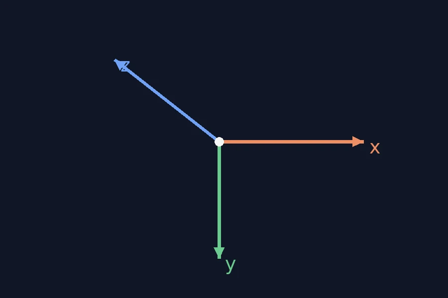

# Térbeli grafika (3D)

A korábbi fejezetben a síkbeli alakzatok helyét és irányát a koordinátarendszer transzformációival határoztuk meg. A térbeli grafikában ugyanezt tesszük, de a pontok és objektumok már **három koordinátával** rendelkeznek: `x`, `y` és `z`. A Processing `P3D` megjelenítési módja lehetővé teszi, hogy ezekből az adatokból térbeli jelenetet rajzoljunk.

A fejezetben a korábban tanult `translate()`, `pushMatrix()` és `popMatrix()` továbbra is használható. Új fogalom lesz a harmadik koordináta, a térbeli forgatás, a kamera és a világítás. Ezekhez sem szükséges transzformációs mátrixokat vagy vetítési képleteket levezetnünk.

## Térbeli alakzatok {#alakzatok}

Térbeli jelenethez a `size()` harmadik paramétereként `P3D`-t kell megadnunk. A rajzfelületen az `x` tengely jobbra, az `y` tengely lefelé mutat, a `z` pedig a képernyő síkjára merőleges irányt jelenti (pozitív értékei a néző felé mutatnak). Az egyszerűbb példákban az objektumokat a rajzfelület közepe körül helyezzük el.



**1. változat – az első kocka.** A `box(150)` 150 egység élhosszúságú kockát készít az aktuális origó köré. A `translate()` a kockát a rajzfelület közepére helyezi, a `rotateX()` és `rotateY()` pedig azért szükséges, hogy több oldalát is lássuk. A `lights()` egyszerű alapvilágítást állít be.

:::processing-example title="Az első térbeli kocka" image="media/01-kocka.webp"
```processing
void setup() {
  size(900, 600, P3D);
}

void draw() {
  background(16, 23, 38);
  lights();
  noStroke();

  translate(width / 2, height / 2, 0);
  rotateX(-0.35);
  rotateY(0.55);

  fill(85, 165, 225);
  box(150);
}
```
:::

A `draw()` minden képkockában újra lefut, de itt a kocka nem mozog, mert a forgatási szögek állandók.

**2. változat – több alakzat eltérő helyen.** A `sphere(55)` gömböt rajzol az origó köré. A `box()` két paraméterrel is használható: `box(szélesség, magasság, mélység)`. A különböző objektumokat a `pushMatrix()` és `popMatrix()` segítségével egymástól független koordinátarendszerben rajzoljuk.

:::processing-example title="Kocka, téglatest és gömb" image="media/02-primitiv.webp"
```processing
void setup() {
  size(900, 600, P3D);
}

void draw() {
  background(16, 23, 38);
  lights();
  noStroke();

  pushMatrix();
  translate(230, 300, 0);
  rotateY(0.4);
  fill(85, 165, 225);
  box(140);
  popMatrix();

  pushMatrix();
  translate(450, 300, 0);
  rotateX(-0.3);
  fill(225, 160, 90);
  box(105, 155, 85);
  popMatrix();

  pushMatrix();
  translate(680, 300, 0);
  fill(190, 115, 225);
  sphere(70);
  popMatrix();
}
```
:::

### Rövid alkalmazás: kockákból épülő város

A térbeli alakzatokból már néhány egymásba ágyazott ciklussal is összetett jelenetet készíthetünk. A következő programban minden épület egy téglatest. A két ciklus az épületek sorát és oszlopát határozza meg, a véletlen szám pedig az egyes épületek magasságát. Ugyanaz a szerkezet működik itt is, amellyel korábban síkbeli rácsokat rajzoltunk.

:::processing-example title="Kockákból és téglatestekből épülő város" image="media/03-varos.webp"
```processing
void setup() {
  size(900, 600, P3D);
  background(17, 24, 39);
  lights();
  noStroke();
  randomSeed(12);

  translate(width / 2, 380, 0);
  rotateX(-0.55);
  rotateY(0.35);

  fill(45, 56, 78);
  box(600, 12, 420);

  for (int row = 0; row < 5; row++) {
    for (int col = 0; col < 7; col++) {
      float h = random(45, 170);
      float x = (col - 3) * 72;
      float z = (row - 2) * 75;

      pushMatrix();
      translate(x, -h / 2 - 6, z);
      fill(75 + row * 18,
           115 + col * 10, 195);
      box(44, h, 44);
      popMatrix();
    }
  }
}
```
:::

A `randomSeed(12)` gondoskodik arról, hogy a véletlen épületmagasságok minden futtatáskor ugyanúgy keletkezzenek, így az eredmény összehasonlítható. Az épületek pozícióját a `col` és a `row` változó határozza meg. A `-h / 2` eltolás azért szerepel, mert a `box()` saját középpontja köré rajzol: így a változó magasságú épületek talpa ugyanarra az alapfelületre kerül.

## Térbeli transzformációk és kamera {#transzformaciok-kamera}

A háromdimenziós környezetben az eltolás három koordinátát kap: `translate(x, y, z)`. A forgatást tengelyenként külön utasítással adjuk meg: `rotateX()`, `rotateY()` és `rotateZ()`. A `scale()` itt is működik, három paraméterrel akár tengelyenként eltérő méretezést is megadhatunk.

**1. változat – egy kocka mozgása.** Most a forgatási szöget a `frameCount` alapján számítjuk, ezért a kocka minden képkockában kissé más irányban áll. A `draw()` kezdetén a koordinátarendszer alaphelyzetbe áll, ezért a forgás a megadott szög szerint történik, nem a korábbi képkocka transzformációiból indul.

:::processing-example title="Két tengely körül forgó kocka" image="media/04-forgo-kocka.webp"
```processing
void setup() {
  size(900, 600, P3D);
}

void draw() {
  background(16, 23, 38);
  lights();
  noStroke();
  translate(width / 2, height / 2, 0);

  rotateX(frameCount * 0.012);
  rotateY(frameCount * 0.018);

  fill(95, 175, 235);
  box(170);
}
```
:::

### A kamera szerepe

A térbeli objektumok elhelyezése és a jelenet megfigyelése két külön feladat. Egy kocka nem változik meg attól, hogy másik helyről nézzük, mégis egészen más kép jelenhet meg róla. A `camera()` megadja a megfigyelő pozícióját, azt a pontot, amelyre néz, valamint a felfelé mutató irányt.

**2. változat – két nézőpont.** A következő program egérkattintáskor más kamerát használ. Az alakzat közben ugyanott marad; csak a megfigyelés iránya változik.

:::processing-example title="Kamera helyzetének megváltoztatása" image="media/05-kamera.webp"
```processing
void setup() {
  size(900, 600, P3D);
}

void draw() {
  background(16, 23, 38);

  if (mousePressed) {
    camera(width / 2, height / 2 - 230, 620,
           width / 2, height / 2, 0,
           0, 1, 0);
  } else {
    camera();
  }

  lights();
  noStroke();
  translate(width / 2, height / 2, 0);
  rotateY(0.55);
  fill(235, 155, 100);
  box(190);
}
```
:::

Az első három paraméter a kamera helyét, a következő három a nézett pontot, az utolsó három pedig a felfelé mutató irányt adja meg. A `camera()` paraméterek nélkül visszaállítja az alapértelmezett kamerát. A perspektivikus nézetben a távolabbi tárgyak kisebbnek látszanak; a `ortho()` párhuzamos vetítése ezt a távolságfüggő méretváltozást megszünteti. Egyelőre elegendő felismerni a különbséget.

## Világítás és külső modellek {#fenyek-modellek}

A térbeli alakzatok felületének megjelenése a fényforrásoktól is függ. A `lights()` gyorsan beállít egy használható alapvilágítást. Ha pontosabban szeretnénk szabályozni a fényeket, használhatunk környezeti (`ambientLight()`), irányított (`directionalLight()`) és pontszerű (`pointLight()`) fényforrást.

**1. változat – egyszerű világítás.** A `lights()` hatására a kocka oldalai eltérő világosságúak lehetnek, így könnyebben érzékeljük a térbeliséget.

:::processing-example title="Kocka alapvilágítással" image="media/06-alapvilagitas.webp"
```processing
void setup() {
  size(900, 600, P3D);
}

void draw() {
  background(16, 23, 38);
  lights();
  noStroke();
  translate(width / 2, height / 2, 0);
  rotateX(-0.3);
  rotateY(0.6);
  fill(230, 170, 115);
  box(190);
}
```
:::

**2. változat – mozgó színes fény.** A `pointLight()` utolsó három paramétere a fényforrás térbeli pozícióját adja meg. Most ezt a pozíciót folyamatosan módosítjuk; ezért a mozdulatlan gömb megvilágítása idővel változik.

:::processing-example title="Mozgó pontfény a gömb körül" image="media/07-pontfeny.webp"
```processing
void setup() {
  size(900, 600, P3D);
}

void draw() {
  background(12, 18, 32);
  noStroke();

  ambientLight(45, 45, 60);

  float lightX = width / 2 +
                 cos(frameCount * 0.03) * 240;
  float lightY = height / 2 +
                 sin(frameCount * 0.03) * 140;

  pointLight(255, 145, 100,
             lightX, lightY, 260);

  translate(width / 2, height / 2, 0);
  fill(210, 220, 245);
  sphere(120);
}
```
:::

### Külső 3D-modell betöltése

Egy térbeli objektumot nem feltétlenül Processingben kell létrehoznunk. Blenderben elkészített modellt például OBJ-formátumban exportálhatunk, majd a `loadShape()` utasítással beolvashatunk. Az OBJ a modell statikus geometriai adatait hordozza; egy teljes Blender-animációt nem játszik le automatikusan. Az importált objektumot viszont Processingben ugyanúgy eltolhatjuk, elforgathatjuk és méretezhetjük, mint egy beépített kockát.

A példához készítettem egy egyszerű, saját OBJ-mintafájlt. [A modell és a szükséges `data` mappa letöltése](media/obj-mintafajl.zip). A ZIP-ben lévő `data/modell.obj` fájlt a Processing-vázlat `data` mappájába kell másolni. Ezután a program változtatás nélkül használható.

:::processing-example title="OBJ-modell importálása és forgatása" image="media/08-obj-modell.webp"
```processing
PShape model;

void setup() {
  size(900, 600, P3D);
  model = loadShape("modell.obj");
  if (model != null) {
    model.disableStyle();
  }
}

void draw() {
  background(16, 23, 38);
  lights();
  noStroke();

  translate(width / 2, height / 2, 0);
  rotateX(-0.25);
  rotateY(frameCount * 0.012);
  fill(120, 205, 215);

  if (model != null) {
    scale(110);
    shape(model);
  }
}
```
:::

A modell betöltését a `setup()` végzi, nem a `draw()`, mert a fájlt csak egyszer kell beolvasnunk. A `model != null` feltétel azt ellenőrzi, hogy sikerült-e a betöltés. A `disableStyle()` segítségével a Processingben megadott `fill()` szín érvényesülhet a modellen.

## Kidolgozott példa – mozgó térbeli kompozíció {#kidolgozott-pelda}

A fejezet végén kockákból és gömbökből álló, forgó térbeli kompozíciót készítünk. Először egyetlen kockagyűrűt rajzolunk meg. Ezután újabb alakzatokat és egymásba ágyazott mozgásokat adunk hozzá, végül a színes fények is a jelenet részévé válnak.

**1. változat – kockák egy kör mentén.** A `TWO_PI * i / 12` a teljes fordulatot 12 egyenlő részre osztja. A `cos()` és a `sin()` ezekből a szögekből számítja ki a kockák helyét az x–z síkban. A `rotateX()` enyhén megdönti az egész kompozíciót, hogy a kockák elrendezése jobban látható legyen.

:::processing-example title="Tizenkét forgó kocka" image="media/09-kompozicio-1.webp"
```processing
void setup() {
  size(900, 600, P3D);
}

void draw() {
  background(10, 16, 30);
  lights();
  noStroke();
  translate(width / 2, height / 2, 0);
  rotateX(-0.45);
  rotateY(frameCount * 0.01);

  for (int i = 0; i < 12; i++) {
    float angle = TWO_PI * i / 12;
    float x = cos(angle) * 200;
    float z = sin(angle) * 200;

    pushMatrix();
    translate(x, 0, z);
    rotateY(angle);
    fill(90, 165, 225);
    box(45);
    popMatrix();
  }
}
```
:::

**2. változat – két eltérő alakzatsor.** A kockák alá újabb, kisebb gömböket helyezünk. Mindkét alakzatsor saját ciklusból készül, ezért a darabszámuk és a sugaraik egymástól függetlenül változtathatók.

:::processing-example title="Kockák és gömbök két gyűrűben" image="media/10-kompozicio-2.webp"
```processing
void setup() {
  size(900, 600, P3D);
}

void draw() {
  background(10, 16, 30);
  lights();
  noStroke();
  translate(width / 2, height / 2, 0);
  rotateX(-0.45);
  rotateY(frameCount * 0.01);

  for (int i = 0; i < 12; i++) {
    float angle = TWO_PI * i / 12;
    pushMatrix();
    translate(cos(angle) * 205, -40,
              sin(angle) * 205);
    fill(90, 165, 225);
    box(44);
    popMatrix();
  }

  for (int i = 0; i < 16; i++) {
    float angle = TWO_PI * i / 16;
    pushMatrix();
    translate(cos(angle) * 125, 65,
              sin(angle) * 125);
    fill(240, 165, 105);
    sphere(15);
    popMatrix();
  }
}
```
:::

**3. változat – hierarchikus mozgás.** A gyűrű mellé egy központi gömböt helyezünk, majd egy kisebb gömböt keringetünk körülötte. Ennek újabb holdja van, ezért ismét egymásba ágyazott `pushMatrix()` és `popMatrix()` hívásokat használunk. A 2D bolygó–hold példánál megismert szerkezet tehát térben is ugyanúgy működik.

:::processing-example title="Hierarchikus mozgás a térbeli kompozícióban" image="media/11-kompozicio-3.webp"
```processing
void setup() {
  size(900, 600, P3D);
}

void draw() {
  background(10, 16, 30);
  lights();
  noStroke();
  translate(width / 2, height / 2, 0);
  rotateX(-0.35);

  fill(155, 115, 235);
  sphere(65);

  pushMatrix();
  rotateY(frameCount * 0.012);
  translate(200, 0, 0);
  fill(90, 165, 225);
  box(55);

  pushMatrix();
  rotateZ(frameCount * 0.035);
  translate(75, 0, 0);
  fill(245, 160, 105);
  sphere(20);
  popMatrix();

  popMatrix();
}
```
:::

**4. változat – összetett kompozíció és világítás.** A végső program az ismétlődő alakzatsorokat metódusba szervezi. Két egymástól eltérő számú és sugarú gyűrűt készítünk, majd hozzáadunk egy központi gömböt és egy mozgó, színes pontfényt. A metódus paraméterei határozzák meg a gyűrű méretét, elemszámát és az alakzatok színét.

:::processing-example title="Mozgó geometrikus térkompozíció" image="media/12-kompozicio-4.webp"
```processing
void setup() {
  size(900, 600, P3D);
}

void draw() {
  background(10, 16, 30);
  noStroke();

  ambientLight(50, 50, 65);
  directionalLight(150, 155, 175,
                   -0.4f, 0.5f, -1);
  pointLight(255, 110, 185,
             width / 2 + cos(frameCount * 0.02) * 260,
             height / 2 - 150, 250);

  translate(width / 2, height / 2, 0);
  rotateX(-0.42);
  rotateY(frameCount * 0.008);

  fill(165, 120, 235);
  sphere(65);

  drawRing(205, -40, 12, 46,
           color(90, 165, 235));
  drawRing(125, 65, 16, 30,
           color(240, 160, 105));
}

void drawRing(float radius, float y,
              int count, float side, color c) {
  for (int i = 0; i < count; i++) {
    float angle = TWO_PI * i / count;

    pushMatrix();
    translate(cos(angle) * radius, y,
              sin(angle) * radius);
    rotateY(angle + frameCount * 0.012);
    fill(c);
    box(side);
    popMatrix();
  }
}
```
:::

Az egész kompozíció együttesen forog, miközben a gyűrűk egyes kockái is saját elfordulást kapnak. A `drawRing()` paraméterezésével ugyanez a szerkesztési elv más darabszámmal, mérettel és színnel is alkalmazható. A `directionalLight()` utolsó három száma a fény irányát adja meg; a `pointLight()` első három száma a fény RGB-színe, az utolsó három a térbeli helye.
